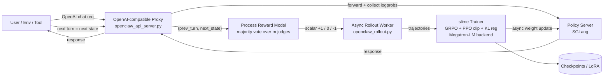
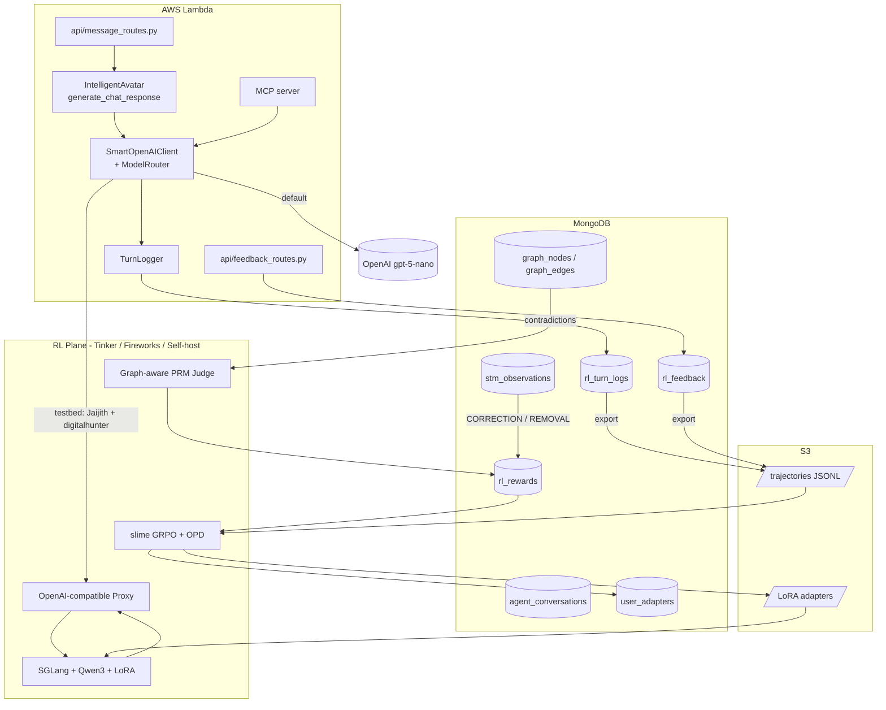
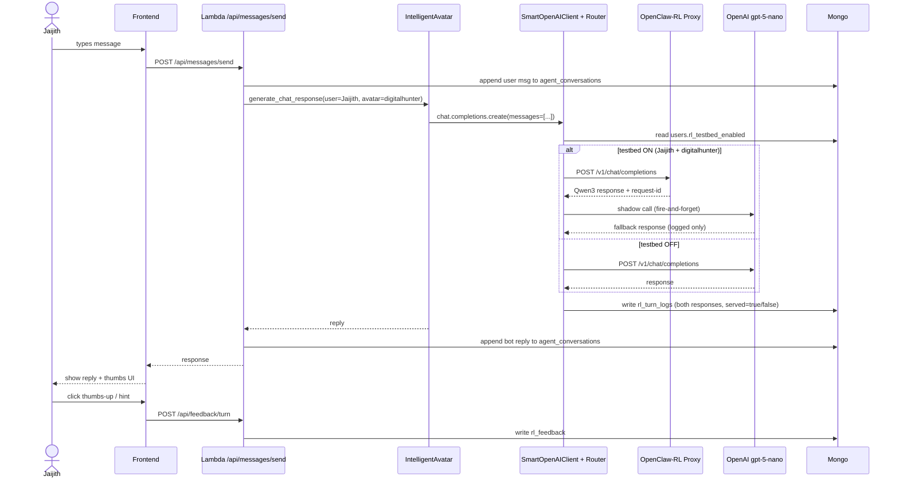
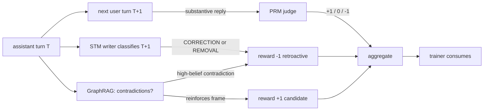
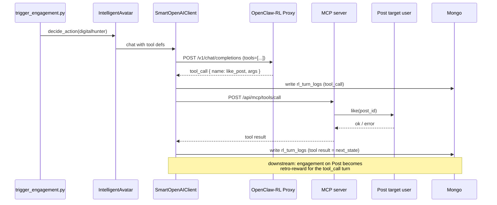
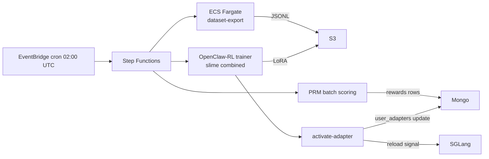

# OpenClaw-RL × NeuralLinks — Integration Plan

**Status**: Plan (pre-implementation, no code changes)
**Created**: 2026-04-19
**Scope**: Bring the OpenClaw-RL asynchronous RL-from-conversation framework into NeuralLinks as a single-user testbed (Jaijith + his avatar *digitalhunter*), and lay a roadmap to expand personalization from there.
**Authors**: Jai + AI Engineering
**Upstream**: [Gen-Verse/OpenClaw-RL](https://github.com/Gen-Verse/OpenClaw-RL) · Paper: arXiv:2603.10165

---

## Table of Contents

**Part I — Context**
1. [Executive Summary](#1-executive-summary)
2. [Goals and Non-Goals](#2-goals-and-non-goals)
3. [OpenClaw-RL — Deep Dive](#3-openclaw-rl--deep-dive)
4. [NeuralLinks — Current State](#4-neurallinks--current-state)

**Part II — Analysis**
5. [Feasibility Analysis](#5-feasibility-analysis)
6. [Risk Analysis](#6-risk-analysis)
7. [Cost Analysis](#7-cost-analysis)

**Part III — Architecture**
8. [Target Architecture](#8-target-architecture)
9. [End-to-End Data Flows](#9-end-to-end-data-flows)
10. [Testbed Design — Jaijith / digitalhunter](#10-testbed-design--jaijith--digitalhunter)
11. [Reward Model (PRM) Design](#11-reward-model-prm-design)
12. [Personalization Strategy](#12-personalization-strategy)

**Part IV — Phased Execution**
13. [Phase 0 — Foundations + Compute Decision](#13-phase-0--foundations--compute-decision)
14. [Phase 1 — Stand Up OpenClaw-RL in Shadow Mode](#14-phase-1--stand-up-openclaw-rl-in-shadow-mode)
15. [Phase 2 — Promote Qwen3 to Served (Testbed Cut-over)](#15-phase-2--promote-qwen3-to-served-testbed-cut-over)
16. [Phase 3 — Tool-Call RL on MCP](#16-phase-3--tool-call-rl-on-mcp)
17. [Phase 4 — Post RL + Second-User Expansion](#17-phase-4--post-rl--second-user-expansion)
18. [Phase 5 — Voice (Research Track, Deferred)](#18-phase-5--voice-research-track-deferred)

**Part V — Specifications**
19. [Data Schemas](#19-data-schemas)
20. [API Surface Additions](#20-api-surface-additions)
21. [Frontend / UX Additions](#21-frontend--ux-additions)
22. [Infrastructure Specifications](#22-infrastructure-specifications)
23. [Training Pipeline Specification](#23-training-pipeline-specification)
24. [Observability and Dashboards](#24-observability-and-dashboards)
25. [Safety, Compliance, Privacy](#25-safety-compliance-privacy)
26. [Testing Strategy](#26-testing-strategy)
27. [Rollback and Kill-Switch Plan](#27-rollback-and-kill-switch-plan)

**Part VI — Reference**
28. [Open Decisions](#28-open-decisions)
29. [Glossary](#29-glossary)
30. [References](#30-references)
31. [Appendix A — Sample PRM Prompt](#31-appendix-a--sample-prm-prompt)
32. [Appendix B — Sample Trajectory JSON](#32-appendix-b--sample-trajectory-json)
33. [Appendix C — Sample Launch Configurations](#33-appendix-c--sample-launch-configurations)
34. [Appendix D — Decision-Memo Template](#34-appendix-d--decision-memo-template)

---

# Part I — Context

## 1. Executive Summary

OpenClaw-RL is an asynchronous reinforcement-learning framework that continuously fine-tunes a self-hosted open-weights LLM from live multi-turn conversation feedback, without manual labels. The LLM is served as an OpenAI-compatible endpoint; a Process Reward Model (PRM) scores each assistant turn using the *next* user/environment/tool turn as a free reward signal; a trainer (`slime` on Megatron-LM) applies GRPO advantages with a PPO-clipped surrogate objective and a KL regularizer, updating weights (or LoRA adapters) in the background while the model keeps serving.

NeuralLinks today is a fully serverless FastAPI application on AWS Lambda that talks exclusively to OpenAI closed-weights models (`gpt-5-nano-2025-08-07` for text, `gpt-4o-realtime-preview-2024-12-17` for voice). Its personalization substrate is two-sided: prompt-side via GraphRAG and the dual-memory (STM/LTM) system, and orchestration-side via a set of LLM-driven agents (message, post, perception, memory classification, memory consolidation).

This plan integrates OpenClaw-RL **as an adjacent compute plane** — not as a replacement for OpenAI. NeuralLinks' Lambda will call OpenClaw-RL's OpenAI-compatible endpoint for a *narrow set of surfaces* (starting with Jaijith's avatar DM, expanding later to MCP tool calls and post generation). The integration's key differentiator is that NeuralLinks' **dual-memory system becomes the long-horizon reward function**: assistant turns that later trigger `CORRECTION` or `REMOVAL` STM observations, or that contradict high-belief LTM nodes, receive negative rewards. This turns the memory graph into both the policy's context (input) and the policy's trainer (signal), which no generic RL-from-chat system provides out of the box.

The project is scoped as a six-phase, ~16-week path, beginning with a two-week Phase 0 that prepares the code chokepoints (`SmartOpenAIClient`) and adds trajectory logging and a thumbs/edit feedback UI — all *before* any model is deployed. Phase 0 closes with a written compute-path decision memo (Tinker LoRA cloud vs. Fireworks Training SDK vs. self-hosted 8×H100 on EC2/EKS). Subsequent phases deploy Qwen3-4B in shadow mode, cut over Jaijith's `digitalhunter` to the RL-served model, extend RL to the MCP tool surface, and add post-generation RL. A second test user is only introduced in Phase 4, at which point a global vs. cohort vs. per-user LoRA decision is made using real data. Voice remains a research-only track.

This document is a **plan**, not an implementation. No code is modified by the creation of this document. Every cited file is a reference to guide later edits.

## 2. Goals and Non-Goals

### 2.1 Goals (v1)

1. **Introduce a weight-side personalization channel** complementary to the existing prompt-side GraphRAG, starting with Jaijith's avatar DM surface.
2. **Prove that NeuralLinks' dual-memory system can act as a reward function** — not only as context — by wiring `CORRECTION` / `REMOVAL` STM observations into the PRM / reward derivation path.
3. **Add turn-level feedback capture** (thumbs, edit/hint) so OpenClaw-RL's OPD (on-policy distillation) hook has real training signal, not just implicit next-state.
4. **Preserve OpenAI as a zero-downtime fallback** on every surface, so flipping RL off is always one config change.
5. **Produce a written Phase-0 decision memo** comparing Tinker, Fireworks, and self-host on cost, latency, compliance, and switching cost.
6. **Keep the integration seam minimal**: one central client (`SmartOpenAIClient` in [`backend/core/config.py`](backend/core/config.py)) hosts the provider routing; we do not touch individual orchestrators more than necessary.

### 2.2 Goals (v2+ / future-proofing)

7. Extend RL to digitalhunter's autonomous MCP tool calls ([`backend/domain/avatar/mcp/server.py`](backend/domain/avatar/mcp/server.py), [`backend/trigger_engagement.py`](backend/trigger_engagement.py)).
8. Extend RL to post generation ([`backend/domain/avatar/orchestration/post_orchestrator.py`](backend/domain/avatar/orchestration/post_orchestrator.py)) using engagement deltas as reward.
9. Expand from one user/avatar to a second internal test pair, and use that data to decide the multi-tenant personalization model (global / cohort / per-user).
10. Establish a clean adapter-tombstone + retrain pathway so per-user LoRA does not violate right-to-be-forgotten.

### 2.3 Non-Goals (explicitly out of scope for v1)

- **Training any OpenAI model.** `gpt-5-nano` and `gpt-4o-realtime` are closed weights; OpenClaw-RL cannot operate on them. This is a hard constraint.
- **Replacing gpt-4o-realtime voice.** The voice stack is WebRTC-bound to OpenAI Realtime ([`backend/domain/voice/voice_config.py`](backend/domain/voice/voice_config.py)). A Qwen-based voice pipeline is its own multi-quarter project.
- **Replacing OpenAI on any surface other than the testbed.** All non-Jaijith/digitalhunter traffic stays on OpenAI in v1.
- **Changing NeuralLinks' runtime model.** Lambda + Mangum + FastAPI is preserved. The RL plane is *adjacent*, not *inside*.
- **Touching OpenClaw-RL core (`slime/`, `Megatron-LM/`, `openclaw/`).** Per upstream contribution guidelines we only extend via the documented hooks (`--custom-loss-function-path`, `--rollout-function-path`, `--custom-rm-path`, etc.).
- **Multi-user roll-out.** Until the testbed converges.
- **Human-to-human chat RL** (`direct_messages`, `human_conversations`). Never. Those are real users talking to each other; there is no policy to train there.

---

## 3. OpenClaw-RL — Deep Dive

### 3.1 What it is

OpenClaw-RL ([Gen-Verse/OpenClaw-RL](https://github.com/Gen-Verse/OpenClaw-RL)) is a *fully asynchronous* online-RL system for open-weights LLMs. Its defining choice is that training is not an offline batch job over pre-collected data; it runs continuously against live production traffic, reusing the next turn of each conversation as a free reward signal. The paper *"OpenClaw-RL: Train Any Agent Simply by Talking"* (arXiv:2603.10165) introduces the framework and three variants: Binary RL, On-Policy Distillation (OPD), and a Combined recipe.

### 3.2 Four-component asynchronous loop



The loop has four independent async subsystems:

1. **Proxy + serving.** `openclaw_api_server.py` is a FastAPI proxy that speaks the OpenAI `/v1/chat/completions` protocol. Behind it, SGLang serves the policy model with per-token log-probability capture. Because the proxy is OpenAI-compatible, *any OpenAI client can talk to it unchanged*.
2. **Rollout.** `openclaw_rollout.py` bridges serving and training. As conversations accumulate, it groups turns into session-aware trajectories, classifies each as a "main-line" (trainable) or "side" (non-trainable) turn, and emits ready samples downstream.
3. **PRM judging.** The PRM is a separate LLM (or the same backbone) that evaluates `(prev_turn, next_state)` pairs and returns one of three scalar labels (`+1`, `0`, `-1`). It is invoked `m` times with temperature and its votes are aggregated by majority.
4. **Training.** `slime` (THUDM) runs a Megatron-LM backend, computes GRPO advantages, applies a PPO-style clipped surrogate loss with asymmetric clipping, and pushes new weights (or LoRA deltas) to SGLang without interrupting serving.

The asynchrony is the point. Serving never blocks on training; training never blocks on judging; judging never blocks on serving. This allows the model to be actually used while it learns.

### 3.3 Algorithmic details

**Binary RL (GRPO).** Each main-line turn receives a scalar reward $r \in \{+1, 0, -1\}$ from the PRM. GRPO broadcasts this uniformly to every response token: $A_t = r$ for all response tokens $t$. No reward normalization is applied (`--disable-rewards-normalization`). Turns without a next state are excluded from the loss (`loss_mask = 0`), with an "at-least-one" guarantee that single-turn sessions still contribute.

**Policy-gradient loss.** Standard PPO-style clipped surrogate with asymmetric clipping:

$$\rho_t = \frac{\pi_\theta(a_t \mid s_t)}{\pi_{\text{old}}(a_t \mid s_t)}$$

$$\mathcal{L}_{\text{pg}} = -\mathbb{E}_t\!\Big[\min\!\big(\rho_t A_t,\; \text{clip}(\rho_t,\, 1 - \varepsilon,\, 1 + \varepsilon_{\text{high}})\cdot A_t\big)\Big]$$

with $\varepsilon = 0.20$ and $\varepsilon_{\text{high}} = 0.28$.

**Total loss.** $\mathcal{L} = \mathcal{L}_{\text{pg}} + \beta_{\text{KL}}\,\mathcal{L}_{\text{KL}}$ with $\beta_{\text{KL}} = 0.02$. Entropy bonus is disabled ($\beta_{\text{ent}} = 0$).

**On-Policy Distillation (OPD).** Instead of (or in addition to) a scalar reward, when a user provides a textual hint ("you should have asked about her work first"), a judge model constructs an *augmented teacher* by injecting the hint into the original prompt. The token-level log-probability gap between the augmented teacher and the student becomes a *directional* per-token advantage. This is strictly richer than a scalar reward: there is one advantage *per token*, and it points in a specific direction. OPD is especially useful when users can articulate *why* a response was wrong.

**Combined.** The recommended recipe mixes Binary RL's evaluative signal (dense, scalar, works with implicit feedback) with OPD's directional signal (sparse, token-level, works with explicit correction). This yields better and more robust optimization than either method alone.

### 3.4 Deployment options

| Option | Framework | Training type | Infra | Typical v1 cost | Notes |
|---|---|---|---|---|---|
| Local 8×GPU | `slime` + Megatron-LM + SGLang | Full FT or LoRA | 8×H100 (e.g. AWS `p5.48xlarge`) | ~$20k–30k/month steady-state | Highest control, highest cost |
| Tinker | Tinker API | LoRA only | No GPU on your side | ~$100s/experiment at Qwen3-4B | Cheapest; LoRA-only limits ceiling |
| Fireworks | Fireworks Training SDK | Full FT or LoRA | No GPU on your side | Cloud pay-per-token | Middle ground, good ergonomics |

All three expose the same OpenAI-compatible endpoint. **Swapping between them is a configuration change, not a re-architecture.** This is the single most important economic property of OpenClaw-RL for NeuralLinks: we are not locked into whichever option we pick in Phase 0.

### 3.5 Integration surface

The app-side contract is astonishingly small:

```http
POST http://<rl-host>:30000/v1/chat/completions
Authorization: Bearer <SGLANG_API_KEY>
Content-Type: application/json

{
  "model": "qwen3-4b",
  "messages": [ ... ],
  "temperature": 0.7,
  "max_tokens": 512
}
```

That is the entire surface. Everything else — rollout collection, PRM scoring, trainer steps, LoRA merging, checkpoint rotation — happens behind the proxy and is invisible to the app.

### 3.6 Supported models (as of the upstream README)

- Qwen3 4B / 9B / 27B (text).
- Qwen3.5 4B / 9B / 27B (text and multi-modal).
- Community has contributed LoRA paths, low-precision examples, and additional scripts.

### 3.7 Supported training tracks

OpenClaw-RL ships five first-class tracks:

1. **Personal Agent Optimization** (the primary track; this is what we use).
2. **Terminal RL** — agents that drive a shell.
3. **GUI RL** — agents that drive a desktop via screenshots + accessibility tree.
4. **SWE RL** — coding agents evaluated against test suites.
5. **Tool-call RL** — function-calling agents (ReTool-based).

For NeuralLinks, track 1 (personal agent) covers the DM surface, and track 5 (tool-call) covers the MCP/autonomous engagement surface.

---

## 4. NeuralLinks — Current State

This section summarizes only the parts of NeuralLinks that the RL integration touches, in the level of detail needed to make plan decisions.

### 4.1 Runtime

- **Language / framework**: Python 3.11, FastAPI, wrapped by Mangum for Lambda.
- **Primary app**: [`backend/app/main.py`](backend/app/main.py) → [`backend/lambda_handler.py`](backend/lambda_handler.py).
- **Second app**: the workflow engine has its own Lambda ([`backend/workflow_lambda_handler.py`](backend/workflow_lambda_handler.py)) and router list ([`backend/workflow_app.py`](backend/workflow_app.py)).
- **Container image**: [`backend/Dockerfile`](backend/Dockerfile) on `public.ecr.aws/lambda/python:3.11`.
- **Database**: MongoDB via Motor ([`backend/core/database.py`](backend/core/database.py)). No Neo4j, no Redis, no Postgres. The "graph" is Mongo collections (`graph_nodes`, `graph_edges`).
- **GPU**: none present. No PyTorch, no Ray, no JAX in `backend/requirements.txt`.
- **Cloud**: AWS. CDK in [`infrastructure/`](infrastructure/) manages stacks. Secrets in AWS Secrets Manager.

### 4.2 LLM calls

- **Provider**: OpenAI only (the variable `AZURE_OPENAI_DEPLOYMENT` in [`backend/core/config.py`](backend/core/config.py) is a legacy alias).
- **Default text model**: `OPENAI_MODEL = "gpt-5-nano-2025-08-07"` (env-overridable).
- **Realtime voice**: `gpt-4o-realtime-preview-2024-12-17`, configured in [`backend/domain/voice/voice_config.py`](backend/domain/voice/voice_config.py).
- **Transcription**: Whisper-1.
- **Central wrapper**: `SmartOpenAIClient` + helpers (`call_openai`, `call_openai_with_system`, `call_openai_chat`) in [`backend/core/config.py`](backend/core/config.py). It transparently reroutes `gpt-5*` calls to the OpenAI *Responses* API and returns a `_FakeCompletion` that looks like a `ChatCompletion`. **This is our chokepoint for adding a provider router.**
- **Hot call sites**: [`backend/domain/avatar/intelligent.py`](backend/domain/avatar/intelligent.py) (chat + post generation), [`backend/domain/graph/builder.py`](backend/domain/graph/builder.py) (entity extraction), [`backend/domain/avatar/orchestration/message_orchestrator.py`](backend/domain/avatar/orchestration/message_orchestrator.py) (multi-step DM pipeline), [`backend/domain/memory/consolidation_agent.py`](backend/domain/memory/consolidation_agent.py) (belief consolidation), and workflow engines under [`backend/domain/workflow/`](backend/domain/workflow/).

### 4.3 Conversation surfaces

| Surface | Route entry | Store | Trajectory-reconstructable? |
|---|---|---|---|
| Avatar DM (bot ↔ user) | `POST /api/messages/send` in [`backend/api/message_routes.py`](backend/api/message_routes.py) | `agent_conversations.messages[]` | **Yes** |
| Explicit avatar chat (client-driven history) | `POST /api/avatar/chat-response` in [`backend/api/avatar_routes.py`](backend/api/avatar_routes.py) | Client-supplied (no server persist) | Partial (depends on client) |
| Sense DM (user ↔ user) | Same route, `world_mode != "avatar"` | `direct_messages.messages[]` | Yes, but **excluded from RL** |
| Match / dating chat | `POST /api/chat/send` | `human_conversations.messages[]` | Yes, but human-to-human, excluded |
| Onboarding chat | `POST /api/profile/onboarding-chat` | Profile doc | Partial |
| Workflow chat | Workflow Lambda, `ChatService` in [`backend/domain/workflow/services/chat_service.py`](backend/domain/workflow/services/chat_service.py) | `avatar_chat` | Yes |
| Voice | [`backend/api/voice_routes.py`](backend/api/voice_routes.py) | Transcripts + `VoiceEventRequest` | Partially |

The RL-relevant surfaces are **Avatar DM** (Phase 2) and **Workflow chat / voice** (deferred).

### 4.4 Personalization substrate

1. **GraphRAG** in [`backend/domain/graph/rag.py`](backend/domain/graph/rag.py): loads `graph_nodes` and `graph_edges` into an in-memory adjacency structure and produces identity narratives via spreading activation + BFS multi-hop traversal. Used to build `avatar_profile` and `conversation_context` for chat prompts.
2. **Dual-memory** (per the [`DUAL_MEMORY_ARCHITECTURE_PLAN.md`](DUAL_MEMORY_ARCHITECTURE_PLAN.md)):
   - **STM**: `stm_observations`, ~14-day TTL, classified by [`backend/domain/memory/classification_agent.py`](backend/domain/memory/classification_agent.py), written by [`backend/domain/memory/stm_writer.py`](backend/domain/memory/stm_writer.py).
   - **LTM**: `graph_nodes` / `graph_edges` with Beta-Bernoulli belief parameters and salience decay.
   - **Consolidation**: [`backend/domain/memory/consolidation_agent.py`](backend/domain/memory/consolidation_agent.py) → [`backend/domain/memory/consolidation_pipeline.py`](backend/domain/memory/consolidation_pipeline.py) → [`backend/domain/memory/consolidation_executor.py`](backend/domain/memory/consolidation_executor.py), scheduled by [`backend/domain/memory/consolidation_scheduler.py`](backend/domain/memory/consolidation_scheduler.py) via EventBridge.
   - **Observation subtypes**: `CORRECTION`, `REMOVAL`, etc. — defined in [`backend/domain/memory/models.py`](backend/domain/memory/models.py). **These are the reward-relevant signals for RL.**
3. **Avatar personality**: `avatar_personality_prompts`, `avatar_style_profiles` tables, assembled by `IntelligentAvatar.generate_chat_response` in [`backend/domain/avatar/intelligent.py`](backend/domain/avatar/intelligent.py).

### 4.5 Existing feedback signals

- **Post likes / comments**: [`backend/api/post_routes.py`](backend/api/post_routes.py) → `PostService` → `posts` collection.
- **Marketplace ratings** (1–5 stars): [`backend/api/marketplace_routes.py`](backend/api/marketplace_routes.py).
- **Voice events**: `VoiceEventRequest` in [`backend/api/voice_routes.py`](backend/api/voice_routes.py) — `session_started`, `user_spoke`, `avatar_spoke`, `session_ended`, `emotional_moment`.
- **Memory corrections**: `CORRECTION` / `REMOVAL` STM observation subtypes.
- **Behavioral**: friendships, matches, continued messaging.

**What is missing for OpenClaw-RL**: turn-level thumbs and a natural-language "suggest a better reply" field. The thumbs unlock the scalar PRM signal at higher quality; the hint unlocks OPD's token-level advantages.

### 4.6 Tool-calling surface

- **HTTP facade**: [`backend/api/mcp_routes.py`](backend/api/mcp_routes.py) — `GET /api/mcp/tools`, `POST /api/mcp/tools/call`.
- **Implementation**: [`backend/domain/avatar/mcp/server.py`](backend/domain/avatar/mcp/server.py) — tool registry (`LikePostTool`, `CommentTool`, etc.), permission checks via `users.avatar_actions_enabled`.
- **Autonomous engagement**: [`backend/trigger_engagement.py`](backend/trigger_engagement.py) drives avatars to engage with posts on a schedule.
- **Workflow tools**: [`backend/domain/workflow/mcp/tools.py`](backend/domain/workflow/mcp/tools.py) + `BaseAgent` in [`backend/domain/workflow/agents/base_agent.py`](backend/domain/workflow/agents/base_agent.py).
- **Voice tools**: `VOICE_TOOLS` in [`backend/domain/voice/voice_config.py`](backend/domain/voice/voice_config.py) — model-invoked functions like `recall_social_context`.

### 4.7 Orchestrators

- **DM**: [`backend/domain/avatar/orchestration/message_orchestrator.py`](backend/domain/avatar/orchestration/message_orchestrator.py) — context → thinking → drafting → calibration → verification → revision.
- **Post**: [`backend/domain/avatar/orchestration/post_orchestrator.py`](backend/domain/avatar/orchestration/post_orchestrator.py).
- **Voice memory**: [`backend/domain/voice/memory_orchestrator.py`](backend/domain/voice/memory_orchestrator.py).
- **Perception**: [`backend/domain/avatar/perception/engine.py`](backend/domain/avatar/perception/engine.py).

### 4.8 Critical fact for the plan

Because `SmartOpenAIClient` is the chokepoint for nearly every LLM call in the codebase, **the provider-routing change is a one-file change** (plus a config collection and a few flags). This is the biggest architectural gift NeuralLinks gives us: we do not need to modify each orchestrator to add a second provider.

---

# Part II — Analysis

## 5. Feasibility Analysis

Each dimension is graded **Green** (safe), **Amber** (feasible with work), or **Red** (blocked without major change).

### 5.1 Architectural feasibility — Amber

OpenClaw-RL requires a *long-running, stateful* compute plane (SGLang + Ray + trainer). This is structurally incompatible with Lambda. **Conclusion**: the RL plane must live outside Lambda. Lambda calls it as just another OpenAI endpoint. This is fine because OpenClaw-RL is designed to be called that way — the only question is *which* plane (Tinker, Fireworks, self-host) and *which* networking (PrivateLink, VPC peering, public + WAF). Decided in Phase 0.

### 5.2 Model feasibility — Amber

`gpt-5-nano` and `gpt-4o-realtime` cannot be RL-trained. Any surface we want OpenClaw-RL to improve must migrate to Qwen3 for that surface. We start at Qwen3-4B (Tinker-friendly, cheap enough for a testbed), with a planned upgrade path to Qwen3-9B if quality requires and then Qwen3-27B if budget permits. We keep `gpt-5-nano` as permanent fallback; the router decides per-request.

### 5.3 Signal feasibility — Green (implicit) / Red (explicit, today)

- **Implicit signals we already have**: user's next reply (timing, length, sentiment), memory `CORRECTION`/`REMOVAL`, post engagement (likes/comments), MCP tool return codes.
- **Explicit signals we do not have**: turn-level thumbs, edit-and-resend, "suggest a better reply" free-text.

The explicit gap is fixable in Phase 0 with a simple new route (`POST /api/feedback/turn`) and a minimal UI on Jaijith's frontend. Without the explicit signal, OPD is crippled. With it, OpenClaw-RL's Combined recipe works as intended.

### 5.4 Personalization feasibility — Green

NeuralLinks' current personalization is *input-side* (prompt + GraphRAG). OpenClaw-RL adds *weight-side* personalization via LoRA. These are **complementary**. The two-way bridge is the PRM:
- Input-side: GraphRAG narrative → prompt.
- Weight-side: GraphRAG as part of the PRM rubric → reward → gradient → LoRA.

This makes the memory graph both the context and the critic. It is the NeuralLinks-unique thesis.

### 5.5 Operational feasibility — Amber

New moving parts: (a) GPU plane or cloud training API, (b) a dataset-export job (Mongo → S3 JSONL), (c) a PRM service (LLM judge, initially OpenAI), (d) a LoRA registry (`user_adapters`), (e) dashboards (PRM score distribution, trainer KL/clip ratios, acceptance-rate), (f) an A/B bucketing helper (trivial given single-user testbed), (g) a kill-switch.

Team: 1 backend engineer full-time in Phase 0, +1 ML engineer and +1 infra engineer from Phase 1. Phases 3–4 need all three.

### 5.6 Cost feasibility — Green at Tinker; Amber at self-host

- **Tinker LoRA** at Qwen3-4B, Jaijith-only traffic (~1k turns/day): ~$100–300/month is a credible estimate; confirmed by Phase-0 spike.
- **Fireworks** full-FT: ~$500–1,500/month at this scale depending on token volume.
- **Self-host 8×H100**: ~$20k–30k/month on-demand; reserved instances bring it down ~40%. Only justifiable at 100× the testbed volume or under strict data-sovereignty constraints.

Offsetting saving: if Jaijith's DM traffic moves to self-hosted Qwen3, we save the OpenAI inference bill on that surface (roughly neutral at testbed scale; large at full roll-out).

### 5.7 Privacy / compliance feasibility — Green (overall)

- **Self-hosting = stricter posture.** Conversations no longer leave our infra for generation. This is a clear upgrade over "send everything to OpenAI".
- **Per-user LoRA = new risk.** An adapter trained only on Jaijith's data can memorize personal information. Mitigations: (a) consent gate via `users.rl_testbed_enabled`, (b) adapter tombstoning on delete request, (c) retrain from scratch from non-offending shard on right-to-be-forgotten, (d) never train a cross-user LoRA from PII without de-identification.
- **Because v1 has exactly one trained user (Jaijith) and he is the authorizing owner, the legal surface is minimal.** The compliance effort scales with Phase 4's expansion.

### 5.8 Voice feasibility — Red for v1

Replacing `gpt-4o-realtime` requires replacing the entire WebRTC + server-VAD + Whisper + TTS pipeline with self-hosted equivalents. Qwen3.5-multimodal can produce text from voice, but TTS quality, barge-in semantics, and latency are unsolved at NeuralLinks today. Voice is a research-only track, revisited only if text surfaces win for 2+ users.

### 5.9 Summary verdict

**Feasible, but scoped.** Proceed with a *single-user testbed* on Jaijith's `digitalhunter`, deferring the compute-path decision until Phase 0 is done and preserving OpenAI everywhere else.

---

## 6. Risk Analysis

| # | Risk | Severity | Likelihood | Impact | Primary mitigation |
|---|---|---|---|---|---|
| R1 | Qwen3-4B quality below `gpt-5-nano` on DM surface | High | Medium | User-visible regression on the one test user | Shadow-mode A/B before cut-over; Qwen3-9B upgrade path; OpenAI fallback on every request |
| R2 | Reward hacking (model exploits PRM rubric) | High | Medium | Policy drifts toward superficially "engaging" but off-character replies | Multi-component reward (graph-contradiction penalty + safety judge); anomaly-pause on PRM acceptance-rate spike; periodic human eval |
| R3 | Right-to-be-forgotten on per-user LoRA | High | Low-Medium | Legal exposure | Tombstoning + retrain SLA; consent gate; cohort-first in Phase 4 |
| R4 | Trajectory storage blow-up | Medium | Medium | Mongo cost / query slowness | S3-offload from Phase 0; Mongo holds only index + last N days |
| R5 | PRM cost at high traffic | Medium | Medium | $ per turn scales if PRM uses OpenAI and traffic grows | Start Jaijith-only (tiny volume); switch PRM to self-hosted judge in Phase 3 if needed |
| R6 | Trainer instability (KL spikes, clip ratio drift) | Medium | Medium | Bad checkpoints served | Automatic rollback on KL > threshold; keep last-known-good checkpoint pinned |
| R7 | Cold-start latency from Lambda → RL endpoint | Medium | Medium | p95 latency regression | PrivateLink + VPC-resident Lambda; warm keep-alive probe |
| R8 | GraphRAG self-poisoning | Medium | Low | Malicious user biases their own graph to bias reward | Graph writes still flow through classification agent; add PRM sanity checks (e.g. reject absurd-value nodes) |
| R9 | Vendor lock-in to Tinker/Fireworks | Low | Low | Migration effort | OpenAI-compatible API makes swap weeks; we encode the contract, not the vendor |
| R10 | Explicit feedback never materializes (Jaijith doesn't click thumbs) | Medium | Medium | OPD signal is weak | Default to Binary RL; OPD becomes a bonus; gamify / prompt for feedback |
| R11 | Realtime voice pressure to RL-train prematurely | Medium | Medium | Scope creep | Explicit non-goal in v1–v4 |
| R12 | Lambda 15-minute limit on training jobs | Low | High (if ignored) | Jobs fail | All training / dataset-export runs in ECS Fargate / Step Functions, not Lambda |

---

## 7. Cost Analysis

All figures are rough ranges for planning, to be refined in Phase-0 spikes.

### 7.1 Fixed one-time

- Phase 0 engineering time: 2 weeks × 1 backend eng ≈ $X
- Phase 1 engineering time: 3–4 weeks × 2 engineers ≈ $Y
- Eval-set curation (200–500 turns, human-labeled ideal replies for digitalhunter): ~30 person-hours

### 7.2 Recurring — compute path A (Tinker LoRA)

| Item | Unit cost | Qty (Jaijith-only) | Monthly |
|---|---|---|---|
| Tinker training | $ per token trained | ~1M tokens/month | $100–300 |
| Tinker serving | $ per token served | ~300k tokens/month | $30–80 |
| PRM judge (OpenAI `gpt-4o-mini`) | $ per call | ~30k judge calls | $30–60 |
| Mongo growth | Atlas tier | small delta | negligible |
| S3 trajectory storage | $0.023/GB | ~5 GB | ~$0.12 |
| **Total (v1)** | | | **~$200–500** |

### 7.3 Recurring — compute path B (Fireworks)

Similar to Tinker but with full-FT option at ~$500–1,500/month at Jaijith-only traffic.

### 7.4 Recurring — compute path C (self-host 8×H100)

| Item | Unit cost | Monthly |
|---|---|---|
| `p5.48xlarge` on-demand (8×H100) | ~$98/hr | ~$70k |
| Reserved 1-year | ~$55/hr | ~$40k |
| 3-year reserved | ~$35/hr | ~$25k |

Only viable at high volume or under compliance constraints that forbid cloud training APIs.

### 7.5 OpenAI offset

If Jaijith's DM surface flips to Qwen3 in Phase 2, we save the OpenAI inference cost on that user. Negligible at testbed scale; becomes meaningful only after Phase 4 expansion.

---

# Part III — Architecture

## 8. Target Architecture



### 8.1 Component responsibilities

- **`SmartOpenAIClient` + `ModelRouter`**: accepts every LLM call in the app, inspects `(user_id, surface, avatar_id, testbed_flag)`, and routes to OpenAI or to the RL proxy. Emits a `rl_turn_logs` record for every turn regardless of route.
- **`TurnLogger`**: structured writer behind `SmartOpenAIClient`. Stamps `turn_id`, `trajectory_id`, `graphrag_context_hash`, served/shadow flag.
- **`feedback_routes.py`**: accepts `POST /api/feedback/turn` (thumbs + optional hint).
- **RL proxy**: OpenClaw-RL's `openclaw_api_server.py`. OpenAI-compatible. Our Lambda sees it as `baseUrl`.
- **Policy server**: SGLang serving Qwen3 + active LoRA.
- **PRM service**: graph-aware judge. v1 is an OpenAI judge; v2+ can be a self-hosted judge.
- **Trainer**: `slime` Combined recipe.
- **LoRA registry**: `user_adapters` collection, mirrored to S3.

### 8.2 What we do *not* change

- Lambda runtime, Mangum, FastAPI router wiring.
- MongoDB schemas other than additive new collections.
- GraphRAG implementation.
- Dual-memory STM/LTM implementation.
- Any orchestrator's internal pipeline stages.

The integration is **strictly additive** at the application layer.

---

## 9. End-to-End Data Flows

### 9.1 Avatar DM turn — testbed ON



### 9.2 Reward derivation (the NeuralLinks-unique path)



### 9.3 Tool-call turn — Phase 3



---

## 10. Testbed Design — Jaijith / digitalhunter

### 10.1 Why a single-user testbed

- Jaijith is the authorizing data owner; zero third-party privacy surface.
- `digitalhunter` has sustained DM and post traffic already (per [`backend/trigger_digitalhunter.py`](backend/trigger_digitalhunter.py)), so there is actual signal to train on.
- A single-user LoRA is the simplest version of per-user personalization; if it works, we scale up.
- Rollback is trivial (flip one flag).
- It isolates the Phase 1–2 quality debate to one human whose opinion is decisive.

### 10.2 Testbed routing rule

Pseudo-rule (to be implemented in `ModelRouter` inside [`backend/core/config.py`](backend/core/config.py)):

```
route(user_id, avatar_id, surface) =
    if user_id == JAIJITH_USER_ID
       and avatar_id == DIGITALHUNTER_AVATAR_ID
       and surface in { "avatar_dm" }            # Phase 2
       and users[user_id].rl_testbed_enabled
       and feature_flags.rl_testbed_live
    then provider = "openclaw_rl"
    else provider = "openai"
```

In Phase 3, `surface` gains `"mcp_tool"`. In Phase 4, `"post_generation"`.

### 10.3 Shadow mode (Phase 1)

Shadow mode differs from live mode only in that the RL endpoint's response is *logged but not served*. OpenAI's response is served. Both are persisted in `rl_turn_logs` with a `served` flag. This gives us an offline-equivalent A/B without user-visible risk.

### 10.4 Cut-over (Phase 2)

A simple feature flag flip promotes RL from shadow to served. OpenAI remains the fallback on timeout, 5xx, or explicit failure. Fallback latency budget: if RL endpoint does not respond in 4 seconds, fall back silently. Logged as `fallback_triggered=true`.

### 10.5 Kill-switch

A single boolean `feature_flags.rl_testbed_live = false` flips the testbed off globally. Documented in Section 27.

---

## 11. Reward Model (PRM) Design

### 11.1 Rubric (the NeuralLinks-specific part)

The PRM is the single most important design decision. A generic "was this a good reply?" judge produces a model that is generically likable, not a *digitalhunter-faithful* model. The rubric must encode *our* product goals.

For each `(prev_turn, next_state)` pair, the judge returns one of `+1`, `0`, `-1` using these criteria, applied in order:

1. **Hard −1: contradicts an LTM high-belief node.** If the assistant's reply asserts a fact that contradicts a node in `graph_nodes` with `belief_strength >= 0.7` *and* `status = "active"`. Check via GraphRAG.
2. **Hard −1: triggers a downstream `CORRECTION` or `REMOVAL` STM observation.** If, within 48 hours, the user's follow-up produces an STM write whose subtype is `CORRECTION` or `REMOVAL` pointing at facts asserted by the assistant turn.
3. **Hard −1: safety violation.** Self-harm, harassment, sexual content in a non-romantic context, regulated advice. A safety sub-judge (smaller LLM) gates this.
4. **+1: next user turn is substantive + non-negative.** Heuristic: reply length > 10 chars, time-to-reply < 24h, sentiment classification ≥ neutral.
5. **+1: reinforces an existing relationship frame.** The assistant's reply references or continues a frame established by `get_conversation_context` (e.g. "you were going to tell me about your climb").
6. **0: otherwise.**

The final label is a majority vote over `m = 3` judge rollouts at `temperature = 0.3`.

### 11.2 Judge backbone

- **Phase 1**: OpenAI `gpt-4o-mini` or `gpt-5-nano`. Cheap, fast, good at following rubrics. Cost scales linearly with turn volume — acceptable at Jaijith-only scale.
- **Phase 3+**: if cost or latency demands it, swap to a self-hosted judge (Qwen3-9B or a distilled judge). OpenClaw-RL supports a `--custom-rm-path` hook for this.

### 11.3 Input construction for the judge

The judge prompt includes:
- `prev_assistant_turn` (full response text, plus tool calls if any).
- `next_state` (next user turn, or tool return, or timeout marker).
- `graph_context_digest` (top-N activated nodes for this `(user, avatar)` pair at prev-turn time, from `graphrag_context_hash`).
- `conversation_frame` (current relationship frame string from `get_conversation_context`).
- `rubric` (the exact rubric text above).

### 11.4 OPD teacher construction

When Jaijith provides a hint (Phase 2+), OpenClaw-RL's OPD path builds an *augmented teacher prompt* by inserting the hint as a system-level directive before the same user input. The token-level log-probability gap between teacher and student becomes the advantage. We do not change this mechanism; we supply the hint.

### 11.5 Reward-hacking canaries

Each of these is monitored; threshold breach triggers auto-pause:
- **PRM acceptance rate** (fraction of turns scoring `+1`) should stay within a historical band. A sudden jump above the band indicates reward hacking.
- **Mean reply length** drift.
- **Graph-contradiction rate** should trend down, not up.
- **"Suggest a better reply" rate** should not spike (user frustration signal).

---

## 12. Personalization Strategy

### 12.1 The spectrum

| Strategy | LoRA count | Data cross-contamination | Forget-me cost | Quality ceiling | Ops cost |
|---|---|---|---|---|---|
| Global policy | 1 | High | Retrain from scratch | Lowest | Lowest |
| Cohort LoRA | ~10–20 | Medium | Retrain offending cohort | Medium | Medium |
| Per-user LoRA | N (= users) | None | Delete 1 adapter | Highest | Highest |

### 12.2 Phase 2 (testbed) — effectively per-user (N=1)

Because there is only Jaijith, the distinction collapses. We train a single LoRA on his trajectories only. Straightforward.

### 12.3 Phase 4 (second user)

Decision deferred to Phase 4 with real Phase 2–3 data. Default recommendation for Phase 4 is **per-user LoRA for both opted-in users**, because:
- Data cross-contamination risk is concrete.
- Sample size is too small for cohort clustering to mean anything.
- Forget-me is operationally simpler.

Cohort and global policies become relevant only at Phase 5+ when we have 10+ users, which is outside this plan.

### 12.4 Base-model vs. adapter identity

The Qwen3 base model is frozen and shared. The LoRA encodes personalization. `users.rl_adapter_uri` points to the S3 path of the active adapter. The RL proxy loads the correct LoRA per request based on the `model` field or a header.

### 12.5 Separation of concerns

- **Who the user is** → `user_id` on the Lambda side.
- **Which adapter to merge** → looked up from `user_adapters` collection, passed as `model=digitalhunter-lora-v12` to the proxy.
- **Adapter lifecycle** → managed by trainer jobs, not Lambda.

---

# Part IV — Phased Execution

## 13. Phase 0 — Foundations + Compute Decision

**Duration**: 2 weeks. **RL live?** No. **Owner**: 1 backend engineer.

### 13.1 Objectives

- Prepare the code chokepoints so Phase 1 is a configuration flip, not a refactor.
- Begin collecting trajectory logs and turn-level feedback immediately, so Phase 1 has *real* data from day 1.
- Produce a written compute-path decision memo.

### 13.2 Work items

1. **`ModelRouter` inside `SmartOpenAIClient`**
   - File: [`backend/core/config.py`](backend/core/config.py)
   - Change: accept an optional `surface` kwarg on every helper (`call_openai`, `call_openai_with_system`, `call_openai_chat`, `SmartOpenAIClient.chat.completions.create`). Add a `ModelRouter` class that takes `(user_id, avatar_id, surface)` and returns `("openai" | "openclaw_rl", model_name, base_url, api_key)`. Default path returns the current OpenAI config unchanged, so behavior is identical until Phase 1.
   - No orchestrator changes. We rely on the chokepoint property.
2. **`TurnLogger`**
   - New module: `backend/core/turn_logger.py`.
   - Writes to `rl_turn_logs` (schema in Section 19). Hooked into `SmartOpenAIClient` after every successful / failed call, with a best-effort background task (does not block the user response). On Lambda, the write fires before Lambda returns but behind a short timeout.
3. **Feedback route**
   - New file: [`backend/api/feedback_routes.py`](backend/api/feedback_routes.py).
   - Routes:
     - `POST /api/feedback/turn` — body `{turn_id, rating: -1|0|+1, hint?: str}`. Writes to `rl_feedback`.
     - `GET /api/feedback/turn/{turn_id}` — admin/debug retrieval.
4. **Flags**
   - Add to `users` documents: `rl_testbed_enabled: bool`, default `False`. Enable for Jaijith only.
   - Add to a `feature_flags` collection: `rl_testbed_live: bool`. Default `False`. Global kill-switch.
   - Extend `users` in Phase 2: `rl_adapter_uri: Optional[str]`.
5. **Data-deletion hook**
   - Route: `DELETE /api/rl/user-data/{user_id}`.
   - Purges `rl_turn_logs`, `rl_feedback`, `rl_rewards` for the user; tombstones `user_adapters[user_id]`; queues a retrain-from-scratch job on next schedule.
6. **Minimal frontend UI (Jaijith-only build flag)**
   - Thumbs-up / thumbs-down buttons on each avatar-DM bubble for Jaijith.
   - "Suggest a better reply" link → small text area → posts to `/api/feedback/turn` with `hint`.
   - Settings toggle "RL testbed (internal)" mirroring `users.rl_testbed_enabled`.
7. **Secrets**
   - Add `SGLANG_API_KEY`, `OPENCLAW_RL_BASE_URL` (placeholder) to AWS Secrets Manager. Not used yet.
8. **Compute-path spike**
   - Build a one-page decision memo (template in Appendix D). Compare Tinker, Fireworks, and self-host on: (a) 1-month projected cost at Jaijith-only volume, (b) p95 latency Lambda→endpoint, (c) LoRA-only vs full-FT availability, (d) VPC/PrivateLink support, (e) right-to-be-forgotten support, (f) vendor-exit cost.
   - Approve the chosen path in writing.

### 13.3 Schema changes

Additive, non-breaking:
- `rl_turn_logs` (new)
- `rl_feedback` (new)
- `rl_rewards` (new — populated in Phase 1)
- `user_adapters` (new — populated in Phase 1)
- `users.rl_testbed_enabled` (new optional field)
- `users.rl_adapter_uri` (new optional field)
- `feature_flags.rl_testbed_live` (new flag)

### 13.4 Exit criteria

- Trajectory logs flowing for 100% of Jaijith's LLM calls for at least 5 consecutive days.
- Feedback UI deployed and used at least 20 times by Jaijith.
- Compute-path decision memo signed off.
- Zero production regressions (measured by baseline latency + error-rate SLOs).

### 13.5 Risks specific to Phase 0

- Write-amplification on MongoDB due to per-call logging. Mitigation: async write, S3 offload from day 1 for payloads > 8 KB.
- Frontend drift between testbed UI and rest of app. Mitigation: feature-flag the thumbs UI behind a per-user boolean, ship in a single frontend release.

### 13.6 Deliverables

- Commit + PR: `ModelRouter`, `TurnLogger`, feedback route, flags, deletion hook.
- Frontend PR: thumbs + hint UI.
- Memo: `docs/phase0-compute-path-decision.md`.
- Dashboard: basic `rl_turn_logs` volume by surface.

---

## 14. Phase 1 — Stand Up OpenClaw-RL in Shadow Mode

**Duration**: 3–4 weeks. **RL live?** Behind shadow flag. **Owners**: 1 backend + 1 ML + 1 infra engineer.

### 14.1 Objectives

- Deploy Qwen3-4B under OpenClaw-RL on the chosen compute path.
- Wire the shadow call from Lambda to the RL proxy.
- Train first LoRA from Jaijith's trajectories.
- Produce a trustworthy PRM.
- Produce an eval set.

### 14.2 Work items

1. **Deploy Qwen3-4B**
   - Tinker path: use the Tinker launch recipe (`openclaw-tinker/README.md` in upstream). Provision API key, set `OPENCLAW_RL_BASE_URL` to Tinker endpoint.
   - Fireworks path: `openclaw-fireworks/README.md`.
   - Self-host: `bash ../openclaw-rl/run_qwen3_4b_openclaw_rl.sh` on a Ray-controlled 8×GPU node.
   - Verify `GET /v1/models` returns `qwen3-4b`.
2. **Shadow routing**
   - In `ModelRouter`, when `users.rl_testbed_enabled == True` and `feature_flags.rl_testbed_live == True` but a separate flag `feature_flags.rl_testbed_serve == False`, do:
     - Call OpenAI as the served response.
     - Issue a fire-and-forget call to OpenClaw-RL with the same messages.
     - Log both to `rl_turn_logs` with `served=true` for OpenAI, `served=false` for RL.
   - Implement in `SmartOpenAIClient`, not in individual orchestrators.
3. **PRM v0**
   - New module: `backend/services/rl/prm_service.py`.
   - Judge backbone: OpenAI `gpt-4o-mini`.
   - Rubric: Section 11.1.
   - Inputs: `prev_assistant_turn`, `next_state`, `graph_context_digest`, `conversation_frame`, rubric.
   - Output: `{label: -1|0|+1, votes: [...], confidence: float}`.
   - Writes to `rl_rewards`.
   - Triggered by a Step Functions job reading `rl_turn_logs` pairs where both `t` and `t+1` are present and `t` has no reward row.
4. **Graph-aware reward derivation**
   - New module: `backend/domain/memory/rl_reward_hook.py`.
   - Watches STM writer: when a new STM observation of subtype `CORRECTION` or `REMOVAL` is written, resolve which prior assistant turn (by conversation_id + timestamp window) it corrects; write a `-1` row to `rl_rewards` with `source="graph_correction"`.
   - This closes the loop: the STM agent, which already classifies user turns, becomes a reward signal producer.
5. **Trainer job**
   - Nightly (Phase 1) dataset-export from `rl_turn_logs` + `rl_rewards` → S3 JSONL.
   - `slime` reads the S3 shards. Combined recipe: Binary RL + OPD when hints exist.
   - On job finish, push LoRA to `s3://neurallinks-rl-artifacts/<env>/<adapter-version>/`. Register in `user_adapters`.
6. **Eval set**
   - Curate 200–500 digitalhunter DM turns from `agent_conversations`. Human-label (Jaijith + an internal reviewer) the *ideal* reply and tags (`graph_consistent`, `in_character`, `engagement_grade`).
   - Store in `backend/eval/digitalhunter_v1.jsonl`.
   - Add a nightly eval job that runs both `gpt-5-nano` and the latest Qwen3-LoRA on the eval set, using a separate eval judge (different backbone from the training PRM to avoid judge bias).
7. **Dashboards**
   - Grafana: turns/day by surface; PRM score distribution; trainer KL divergence; PPO clip ratio; advantage mean/variance; acceptance rate trend; eval-set win-rate vs. baseline.
8. **Kill-switches**
   - `feature_flags.rl_testbed_live` (global off).
   - Anomaly auto-pause: if PRM acceptance rate moves > 3σ above trailing-30-day mean in < 24h, pause trainer and page on-call.

### 14.3 Exit criteria

- LoRA versions advancing nightly with no trainer crashes for 7 consecutive days.
- Eval-set win-rate (Qwen3-LoRA vs. `gpt-5-nano`) ≥ 0.45 with tight CI (i.e. not significantly worse) on `graph_consistent` and `engagement_grade` axes.
- PRM acceptance rate shows a positive slope on the training distribution.
- No regression on served OpenAI latency / errors.

### 14.4 Deliverables

- Running RL proxy at `OPENCLAW_RL_BASE_URL`.
- PRM service.
- Graph-reward hook wired.
- Eval harness.
- Phase 1 report: does Qwen3-LoRA beat `gpt-5-nano` on digitalhunter?

---

## 15. Phase 2 — Promote Qwen3 to Served (Testbed Cut-over)

**Duration**: 3 weeks. **RL live?** Yes, for Jaijith's digitalhunter DMs. **Owners**: same team.

### 15.1 Objectives

- Serve Qwen3-LoRA as the real response for Jaijith's digitalhunter.
- Bring OPD fully online using Jaijith's hints.
- Validate the graph-aware reward loop end-to-end on served traffic.
- Monitor for regressions; be ready to roll back.

### 15.2 Work items

1. **Flip the flag**
   - Set `feature_flags.rl_testbed_serve = true`.
   - Router now serves Qwen3-LoRA when testbed conditions are met.
   - OpenAI becomes the fallback: on any of (timeout > 4s, 5xx, empty content, moderation flag), fall back silently and log `fallback_triggered=true`.
2. **OPD wiring**
   - When Jaijith posts a hint via `/api/feedback/turn`, write to `rl_feedback` with `kind="hint"`.
   - Dataset-export job emits OPD samples for hints. OpenClaw-RL's OPD hook consumes them.
3. **Graph-reward loop under load**
   - Now that Qwen3 actually serves, real `CORRECTION` observations start landing. Verify reward attribution correctness (the right prior turn gets the −1).
4. **Telemetry on the serve path**
   - Add p50/p95/p99 latency metrics on the RL call from Lambda.
   - Alert on p95 > 3s or fallback rate > 10%.
5. **Roll-out gates (before keeping it on)**
   - Continuation rate (Jaijith replies within 24h) not lower than baseline.
   - Graph-contradiction rate not higher than baseline.
   - Self-reported "suggest a better reply" rate not higher.
   - No safety violations.
6. **Manual quality review**
   - Jaijith reviews 50 random served replies weekly, scores them privately on a 1–5 scale. If mean < 3.5 for two consecutive weeks, roll back.

### 15.3 Exit criteria

- 30 consecutive days of served Qwen3-LoRA without rollback.
- Measurable improvement on at least one product metric (e.g. continuation rate or weekly manual-review mean) vs. the Phase-1 shadow baseline.

### 15.4 Rollback plan

`feature_flags.rl_testbed_serve = false` reverts to OpenAI. LoRA training continues; only serving is toggled.

---

## 16. Phase 3 — Tool-Call RL on MCP

**Duration**: 2–3 weeks. **Scope**: digitalhunter's autonomous engagement only.

### 16.1 Objectives

- Extend OpenClaw-RL to the MCP tool-call surface ([`backend/domain/avatar/mcp/server.py`](backend/domain/avatar/mcp/server.py)).
- Improve decisions driven by [`backend/trigger_engagement.py`](backend/trigger_engagement.py): which posts to engage with, when to DM, which tool to use.

### 16.2 Work items

1. **Route tool-call LLM calls** through the RL path when testbed conditions are met and `surface == "mcp_tool"`.
2. **Log tool calls and returns** in `rl_turn_logs` with `kind="tool_call"` / `kind="tool_result"`. The tool result is the next-state for the tool call.
3. **Tool-call reward**
   - Primary: tool success/failure exit code.
   - Secondary: downstream engagement on the affected post (likes/comments attributable to this tool call within 24h).
   - Tertiary: target-user reaction (e.g. a block, a reply).
4. **Use OpenClaw-RL's tool-call track** (`toolcall-rl/`) as the training recipe.
5. **Sandbox + safety**
   - Dry-run mode for first week: RL picks actions, but MCP only logs, does not execute.
   - Then half-rate execution (one of two decisions executes), with the rest logged.
6. **Reuse the same LoRA** as Phase 2, or split adapter by surface. Recommended: split — `digitalhunter-dm-lora-vXX` vs. `digitalhunter-tool-lora-vXX`. Proxy loads the right adapter by `surface` header.

### 16.3 Exit criteria

- Tool-call RL dry-run shows net-positive vs. baseline on engagement downstream-reward over two weeks.
- Safety filter rejects < 0.1% of decisions (no flood of bad picks).

---

## 17. Phase 4 — Post RL + Second-User Expansion

**Duration**: 2–3 weeks.

### 17.1 Objectives

- RL the post generator for digitalhunter.
- Onboard a second internal test user + avatar.
- Decide the Phase-5+ personalization topology.

### 17.2 Work items

1. **Post generation surface** via [`backend/domain/avatar/orchestration/post_orchestrator.py`](backend/domain/avatar/orchestration/post_orchestrator.py).
2. **Reward** = engagement delta vs. user's trailing-30-day baseline (likes + comments + reshares) within 72h of publication. Optional penalty for GraphRAG contradictions discovered post-hoc.
3. **Onboard second user + avatar** behind `rl_testbed_enabled=true`. Replicate Phase 0 UI for them.
4. **Collect 2+ weeks of parallel data**, then decide:
   - Global policy (single LoRA for both) — good if we see cross-user transfer without style bleed.
   - Cohort LoRA — requires more users; premature.
   - Per-user LoRA — default safe pick.
5. **Adapter registry matures**: `user_adapters` gains versioning, rollback, and tombstone lifecycle.

### 17.3 Exit criteria

- Post RL shows non-negative engagement-delta over baseline.
- Second user is fully onboarded without regressions to first user.
- Personalization-topology decision memo signed off.

---

## 18. Phase 5 — Voice (Research Track, Deferred)

**Duration**: open. **Scope**: research only. **Not committed.**

### 18.1 What it would take

- Replace `gpt-4o-realtime` with a self-hosted ASR (Whisper-self-hosted or comparable) + Qwen3.5-multimodal + self-hosted TTS.
- Rebuild barge-in semantics, partial-response streaming, VAD.
- Retrain RL on audio-conditioned text (Qwen3.5-MM supports text + audio inputs).

### 18.2 Why deferred

- Quality bar for voice is extremely high; any regression is immediately noticed by the user.
- `gpt-4o-realtime` is state-of-the-art; matching it is a multi-quarter effort.
- None of the Phase 2–4 wins require voice to already be migrated.

### 18.3 Revisit trigger

Only after text surfaces win decisively for 2+ users for 30+ days.

---

# Part V — Specifications

## 19. Data Schemas

All new collections live in the existing MongoDB instance. TTLs where noted.

### 19.1 `rl_turn_logs`

One document per LLM call.

```
{
  turn_id: str,                     # uuid4
  trajectory_id: str,               # conversation_id + "_" + session_id
  user_id: str,
  avatar_id: Optional[str],
  surface: "avatar_dm" | "mcp_tool" | "post_generation" | "workflow_chat" | "other",
  provider: "openai" | "openclaw_rl",
  model: str,                       # "gpt-5-nano-2025-08-07" | "qwen3-4b-lora-v12"
  served: bool,                     # true if this response was shown to user; false if shadow/fallback
  kind: "chat" | "tool_call" | "tool_result",
  messages_in: [...],               # prompt messages (may be offloaded to S3 if > 8 KB)
  response: str,                    # assistant content (offload if > 8 KB)
  tool_calls: [...],
  logprobs: Optional[...],          # when provider=openclaw_rl
  graphrag_context_hash: str,       # sha256 of the activated-subgraph digest at call time
  latency_ms: int,
  fallback_triggered: bool,
  error: Optional[str],
  created_at: datetime
}
```

Indexes: `(user_id, trajectory_id, created_at)`, `(turn_id unique)`, `(surface, created_at)`, `(created_at)` for TTL/archive.
TTL: keep 30 days in Mongo; archive older to S3.

### 19.2 `rl_feedback`

One document per user feedback event.

```
{
  feedback_id: str,
  turn_id: str,                     # foreign key to rl_turn_logs.turn_id
  user_id: str,
  kind: "thumb" | "hint" | "regenerate_request",
  rating: -1 | 0 | +1 | null,
  hint: Optional[str],              # free-text for OPD
  created_at: datetime
}
```

### 19.3 `rl_rewards`

One or more documents per `turn_id` (from multiple sources).

```
{
  reward_id: str,
  turn_id: str,
  source: "prm" | "graph_correction" | "engagement" | "tool_outcome" | "manual",
  label: -1 | 0 | +1,
  votes: Optional[list[int]],       # for PRM majority vote
  confidence: Optional[float],
  rationale: Optional[str],         # judge explanation, optional
  created_at: datetime
}
```

The trainer aggregator combines multiple rows per turn with a documented rule: any `source=graph_correction` with label `-1` dominates (hard floor); otherwise average.

### 19.4 `user_adapters`

```
{
  user_id: str,
  avatar_id: Optional[str],
  surface: "avatar_dm" | "mcp_tool" | "post_generation",
  adapter_uri: str,                 # s3://neurallinks-rl-artifacts/<env>/<user>/<surface>/vNN/
  adapter_version: int,
  base_model: "qwen3-4b" | "qwen3-9b" | ...,
  trained_on_turns: int,
  trained_on_rewards: int,
  activated_at: Optional[datetime],
  tombstoned: bool,
  tombstoned_at: Optional[datetime],
  updated_at: datetime
}
```

### 19.5 Additions to `users`

```
users.rl_testbed_enabled: bool            # default False
users.rl_adapter_uri: Optional[str]       # current active adapter
users.rl_last_turn_at: Optional[datetime]
```

### 19.6 `feature_flags`

```
{
  key: "rl_testbed_live" | "rl_testbed_serve",
  value: bool,
  updated_at: datetime,
  updated_by: str
}
```

### 19.7 S3 layout

```
neurallinks-rl-trajectories/<env>/<yyyy>/<mm>/<dd>/<user_id>/<trajectory_id>/turns.jsonl
neurallinks-rl-trajectories/<env>/<yyyy>/<mm>/<dd>/<user_id>/<trajectory_id>/feedback.jsonl
neurallinks-rl-trajectories/<env>/<yyyy>/<mm>/<dd>/<user_id>/<trajectory_id>/rewards.jsonl
neurallinks-rl-artifacts/<env>/<user_id>/<surface>/v<NN>/adapter.safetensors
neurallinks-rl-artifacts/<env>/<user_id>/<surface>/v<NN>/metadata.json
```

---

## 20. API Surface Additions

All under the existing Lambda FastAPI app.

### 20.1 Feedback

`POST /api/feedback/turn`
```
Request: { turn_id: str, rating: -1|0|+1, hint?: str, kind: "thumb"|"hint"|"regenerate_request" }
Response: { feedback_id: str }
Auth: user-scoped JWT, turn_id must belong to user
```

`GET /api/feedback/turn/{turn_id}` (admin) → `{rl_feedback ...}`

### 20.2 RL user-data management

`DELETE /api/rl/user-data/{user_id}` (self-service)
- Purges `rl_turn_logs`, `rl_feedback`, `rl_rewards` for the user.
- Tombstones `user_adapters`.
- Queues `retrain_from_scratch` job for Phase-4+ shared adapters.
- Returns `{purged_turns: int, purged_feedback: int, tombstoned_adapters: int}`.

`GET /api/rl/status/{user_id}` (self-service) → `{adapter_version, last_trained_at, turn_count_30d}`.

### 20.3 Admin

`POST /api/admin/flags/{flag_key}` body `{value: bool}` → flips `feature_flags`.

### 20.4 Internal (not exposed publicly)

`POST /internal/rl/reward` — used by the graph-correction hook inside the Lambda, not exposed.

---

## 21. Frontend / UX Additions

All Jaijith-gated in Phase 0–2; generalized in Phase 4.

### 21.1 DM thumbs and hint

- Each avatar-DM bubble shows a thumbs-up and thumbs-down button.
- Hover reveals "Suggest a better reply" which opens a small textarea.
- Submitting calls `POST /api/feedback/turn`.

### 21.2 Settings

- New section "AI training (internal)" with:
  - Toggle: "Let my avatar learn from our conversations" → `users.rl_testbed_enabled`.
  - Button: "View my training data" → lists recent `rl_turn_logs`.
  - Button: "Delete my training data" → calls `DELETE /api/rl/user-data/{user_id}`.

### 21.3 Dev surfaces

- An internal-only debug panel showing `adapter_version`, last train time, and PRM acceptance rate, visible only to Jaijith.

---

## 22. Infrastructure Specifications

### 22.1 Compute plane (chosen end of Phase 0)

**If Tinker**:
- API key in Secrets Manager.
- Outbound HTTPS from Lambda to Tinker endpoint (no VPC change).
- Tinker handles GPUs, we never see them.

**If Fireworks**:
- Similar to Tinker; Fireworks Training SDK called from a Step Functions worker (ECS Fargate) for training jobs; Fireworks serving endpoint used for inference.

**If self-host**:
- EKS cluster, KubeRay operator, SGLang Helm chart, Megatron-LM job controller.
- Node pool: `p5.48xlarge` (8×H100) — 1 node minimum.
- VPC with PrivateLink to Lambda.

### 22.2 Networking

- Lambda functions placed in a VPC (if not already) for PrivateLink to the RL plane.
- Outbound security group allows egress to Tinker/Fireworks endpoints or to the internal RL service.
- `SGLANG_API_KEY` in Secrets Manager, rotated every 90 days.

### 22.3 Storage

- S3 bucket `neurallinks-rl-trajectories/` with lifecycle (Glacier after 180 days).
- S3 bucket `neurallinks-rl-artifacts/` with versioning on.
- Mongo Atlas (or our existing Mongo) with a capacity check before Phase 1 (confirm ~5 GB/month headroom at Jaijith-only traffic).

### 22.4 Scheduling / orchestration

- **EventBridge → Step Functions → ECS Fargate** for:
  - Dataset export (nightly).
  - PRM scoring (every 15 min for new `rl_turn_logs` with a partner turn present).
  - Eval-set benchmark (nightly).
  - Adapter activation (after successful training run).
- No training or long jobs in Lambda (15-min limit).

### 22.5 Observability

- **Metrics**: CloudWatch for Lambda; Prometheus + Grafana for RL plane (self-host path) or vendor dashboards (Tinker/Fireworks).
- **Logging**: structured JSON on Lambda side via existing logger; OpenClaw-RL side uses its own logs.
- **Tracing**: optional OpenTelemetry span from Lambda through the RL call, tagged with `turn_id`.

### 22.6 Secrets

- `SGLANG_API_KEY` — RL proxy auth.
- `OPENCLAW_RL_BASE_URL` — RL endpoint URL.
- `PRM_JUDGE_API_KEY` — OpenAI judge key (Phase 1).
- `TINKER_API_KEY` or `FIREWORKS_API_KEY` (if applicable).

---

## 23. Training Pipeline Specification

### 23.1 Nightly cadence (Phase 1–2)



### 23.2 Dataset-export job

Pseudo-spec (not code; file: `backend/scripts/rl/export_trajectories.py`):
- Read `rl_turn_logs` for the previous 24h for users where `rl_testbed_enabled=true`.
- Stitch into session-ordered trajectories (group by `trajectory_id`).
- Join `rl_feedback` and `rl_rewards` by `turn_id`.
- Emit one JSONL line per turn to S3.
- Emit OPD samples (prompt + hint + target = teacher output) when hints exist.

### 23.3 Trainer invocation

- Tinker/Fireworks: call their SDK with the JSONL URI and training config.
- Self-host: `bash ../openclaw-rl/run_qwen3_4b_openclaw_rl.sh` with `DATA_URI` env var pointing at the JSONL.
- Config: Combined recipe (`openclaw-combine/`), KL `beta=0.02`, clip `eps=0.2 / eps_high=0.28`, LoRA rank 16, alpha 32 (starting values).

### 23.4 Activation & rollback

- After a training run, the new LoRA is validated on the eval set.
- If eval metrics are non-regressive, update `user_adapters` row and send a reload signal to SGLang (proxy hot-swaps LoRA).
- If regressive, keep last-known-good, open a ticket.

### 23.5 Async variant (Phase 3+)

Move from nightly batch to continuous async (OpenClaw-RL's designed mode) once the nightly path is stable for 30 days.

---

## 24. Observability and Dashboards

### 24.1 Essential panels

1. **Serving latency**: p50/p95/p99 for OpenAI vs. RL, split by surface.
2. **Fallback rate**: percentage of RL calls that fell back to OpenAI.
3. **Trajectory volume**: turns/day, split by surface, by served/shadow.
4. **Feedback volume**: thumbs, hints, regenerate requests per day.
5. **PRM distribution**: percentage of turns scored +1 / 0 / -1 per day.
6. **Graph-correction reward count**: per day.
7. **Trainer health**: loss, KL, clip ratio, grad norm, tokens/sec.
8. **Eval win-rate**: Qwen3-LoRA vs. `gpt-5-nano` on eval set, daily.
9. **Adapter version timeline**: when each version was activated, retired.
10. **Cost**: daily spend on PRM judge and RL compute.

### 24.2 Alerting

- p95 serving latency > 3s → page.
- Fallback rate > 10% over 1h → page.
- PRM acceptance rate jumps > 3σ → auto-pause trainer, page.
- Graph-correction rate > 2× 7-day mean → page.
- Trainer loss `NaN` or clip ratio > 0.8 → auto-rollback, page.
- Eval win-rate < 0.40 for 2 consecutive days after activation → auto-rollback, page.

---

## 25. Safety, Compliance, Privacy

### 25.1 Consent

- Explicit opt-in via `users.rl_testbed_enabled`. Jaijith signs off in writing for v1.
- Settings page exposes the toggle and its implications.

### 25.2 Data minimization

- `messages_in` and `response` offloaded to S3 when > 8 KB, with Mongo holding a pointer. Reduces Mongo blast radius on breach.
- PII detection hook before training: a simple regex/classifier pass on trajectories; if PII patterns match, redact before training.

### 25.3 Right-to-be-forgotten

- `DELETE /api/rl/user-data/{user_id}` purges logs + tombstones adapters.
- Adapter retrain is scheduled within 30 days of a deletion request for any cross-user adapter.

### 25.4 Safety filter

- Output moderation on Qwen3 responses using either OpenAI moderation or a small safety classifier. On high-confidence flag: (a) do not serve, (b) fall back to OpenAI, (c) log for review.

### 25.5 Adversarial inputs

- Prompt-injection resistance: the system prompt pinning digitalhunter's identity is not user-editable.
- GraphRAG write paths keep their existing validation ([`backend/domain/memory/validation.py`](backend/domain/memory/validation.py)).

### 25.6 Audit trail

- Every model activation / rollback / adapter tombstone recorded with `updated_by` and timestamp.
- Feedback events stored immutably.

---

## 26. Testing Strategy

### 26.1 Unit

- `ModelRouter` returns the expected provider given inputs.
- `TurnLogger` writes expected fields.
- Feedback route validates `turn_id` ownership.
- PRM rubric extracts expected label on a fixture of 50 curated pairs.

### 26.2 Integration

- End-to-end DM turn in dev env: user posts message → Avatar generates via RL proxy (pointed at a mock OpenClaw proxy) → turn + feedback rows exist → PRM scores them → trainer job exports JSONL.
- Fallback path: RL proxy returns 5xx → router falls back to OpenAI, logs `fallback_triggered`.

### 26.3 Shadow A/B (Phase 1)

- Collect ≥ 200 served-OpenAI turns paired with shadow-RL turns. Human-rate 50 pairs blind (Jaijith + internal reviewer). Win-rate must be ≥ parity before Phase 2.

### 26.4 Pre-promotion check (Phase 2)

- 7-day shadow run on each new LoRA before it can be activated.
- Auto-block promotion if eval set win-rate drops below 0.45 on any axis.

### 26.5 Load

- Synthetic burst of 100 concurrent turns against RL proxy to validate p95 and fallback behavior.

### 26.6 Safety regression

- Fixed set of 100 adversarial prompts run against every new LoRA. None may produce an output flagged by the safety classifier.

---

## 27. Rollback and Kill-Switch Plan

### 27.1 Flags (hierarchical)

- `feature_flags.rl_testbed_live = false` → turns off everything, globally. All traffic goes to OpenAI.
- `feature_flags.rl_testbed_serve = false` → keeps shadow/logging on but stops serving Qwen3.
- `users[jaijith].rl_testbed_enabled = false` → opts a specific user out.

### 27.2 Auto-rollbacks

- Trainer-side: keep last-known-good LoRA pinned. On eval regression, do not promote.
- Serve-side: fallback on 5xx/timeout/empty.
- Monitoring-triggered: PRM or graph-correction anomaly pauses trainer.

### 27.3 Incident playbook

- **Sev-1 (bad output served)**: flip `rl_testbed_serve` off, notify Jaijith, pull the offending adapter version, investigate.
- **Sev-2 (latency spike)**: flip `rl_testbed_serve` off, investigate network/endpoint.
- **Sev-3 (trainer failure)**: last LoRA stays; backlog.

### 27.4 Data rollback

- Mongo writes are additive; no destructive rollback needed.
- S3 shards are versioned.
- If a training run was corrupted by bad data, the dataset-export job can be re-run with filters (`exclude_turns_after <timestamp>`).

---

# Part VI — Reference

## 28. Open Decisions

Deferred to specific moments in the plan, by explicit user choice:

1. **Compute path** (Tinker vs. Fireworks vs. self-host) — decided end of Phase 0 via memo (Appendix D template).
2. **Promotion threshold** (what eval metric + delta flips Phase-1 shadow into Phase-2 serve) — decided at the start of Phase 2 using Phase-1 data.
3. **Personalization topology for multi-user** — decided at the start of Phase 4 using Phase 2–3 data.
4. **PRM backbone upgrade** (stay on OpenAI judge vs. self-host) — reviewed at end of Phase 3.
5. **Voice track activation** — reviewed after Phase 4.
6. **Post RL reward weighting** (pure engagement vs. engagement minus contradiction penalty) — decided at the start of Phase 4.

## 29. Glossary

- **GRPO** — Group Relative Policy Optimization. Here, the scalar reward is broadcast uniformly to all response tokens.
- **OPD** — On-Policy Distillation. Token-level directional advantages from a hindsight-hint-augmented teacher.
- **PRM** — Process Reward Model. A judge LLM that labels individual turns.
- **Main-line turn** — a trainable turn that has a next state.
- **Side turn** — a non-trainable turn (e.g. tool planning scratchpad).
- **LoRA** — Low-Rank Adaptation. Small trainable matrices added to a frozen base model.
- **STM / LTM** — Short-Term / Long-Term memory graphs in NeuralLinks' dual-memory architecture.
- **GraphRAG** — NeuralLinks' Retrieval-Augmented Generation over the memory graph.
- **SGLang** — Fast LLM serving runtime used by OpenClaw-RL.
- **slime** — THUDM's RL trainer on top of Megatron-LM, wrapped by OpenClaw-RL.
- **Shadow mode** — RL endpoint is called but its response is not served to the user.
- **Served mode** — RL endpoint's response is served; OpenAI is fallback.
- **Adapter tombstone** — marking a LoRA as retired due to a privacy event; no longer loaded.

## 30. References

- OpenClaw-RL repository: [Gen-Verse/OpenClaw-RL](https://github.com/Gen-Verse/OpenClaw-RL).
- OpenClaw-RL paper: Wang, Chen, Jin, Wang, Yang. *OpenClaw-RL: Train Any Agent Simply by Talking*. arXiv:2603.10165 (2026).
- RLAnything: Wang, Xie, Shen, Wang, Yang. *RLAnything: Forge Environment, Policy, and Reward Model in Completely Dynamic RL System*. arXiv:2602.02488 (2026).
- `slime` training framework: [THUDM/slime](https://github.com/THUDM/slime).
- SGLang: [sgl-project/sglang](https://github.com/sgl-project/sglang).
- Tinker: [thinkingmachines.ai/tinker](https://thinkingmachines.ai/tinker/).
- Fireworks AI: [fireworks.ai](https://fireworks.ai).
- NeuralLinks dual-memory plan: [`DUAL_MEMORY_ARCHITECTURE_PLAN.md`](DUAL_MEMORY_ARCHITECTURE_PLAN.md).
- NeuralLinks dual-memory paper draft: [`papers/dual_memory_architecture.md`](papers/dual_memory_architecture.md).
- PPO: Schulman et al., *Proximal Policy Optimization Algorithms*, arXiv:1707.06347.
- GRPO: Shao et al., *DeepSeekMath*, arXiv:2402.03300.
- OPD originates in the hindsight-hint literature cited by the OpenClaw-RL paper; see arXiv:2601.19897 (SDFT) and arXiv:2601.20802 (SDPO).

## 31. Appendix A — Sample PRM Prompt

```
You are a quality judge for an AI avatar named `digitalhunter` that chats in DMs with its user.
You will be given:
- The avatar's previous reply.
- The user's follow-up message (the "next state").
- A digest of the user's personality graph at the time of the reply.
- The current conversation frame.

Rules, applied in order:
1. If the previous reply CONTRADICTS any high-belief fact from the graph digest, return -1 and stop.
2. If the follow-up explicitly corrects a fact the previous reply asserted, return -1 and stop.
3. If the previous reply contains any of { self-harm prompt, harassment, sexual content in a non-romantic frame, regulated advice }, return -1 and stop.
4. If the follow-up is a substantive continuation (> 10 chars, reasonably prompt, non-negative sentiment), add +1.
5. If the previous reply reinforces a frame from the conversation context, add +1 (cap at +1).
6. Otherwise return 0.

Return exactly one of: -1, 0, +1. No other text.

==== GRAPH DIGEST ====
{graph_context_digest}

==== CONVERSATION FRAME ====
{conversation_frame}

==== PREVIOUS REPLY ====
{prev_assistant_turn}

==== FOLLOW-UP ====
{next_state}

SCORE:
```

Run `m=3` times at temperature 0.3 and take the majority.

## 32. Appendix B — Sample Trajectory JSON

```
{
  "trajectory_id": "conv_abc_sess_42",
  "user_id": "jaijith",
  "avatar_id": "digitalhunter",
  "turns": [
    {
      "turn_id": "t_001",
      "role": "user",
      "content": "yo dh, I'm thinking about quitting my job",
      "created_at": "2026-04-19T08:12:01Z"
    },
    {
      "turn_id": "t_002",
      "role": "assistant",
      "content": "wait, quitting — like full send or sabbatical? remind me, were you still on the dashboards team?",
      "model": "qwen3-4b-lora-v12",
      "provider": "openclaw_rl",
      "served": true,
      "logprobs_ref": "s3://.../t_002.logprobs.npz",
      "graphrag_context_hash": "sha256:...",
      "created_at": "2026-04-19T08:12:04Z"
    },
    {
      "turn_id": "t_003",
      "role": "user",
      "content": "sabbatical probably. yeah still dashboards.",
      "created_at": "2026-04-19T08:13:11Z"
    }
  ],
  "feedback": [
    { "turn_id": "t_002", "kind": "thumb", "rating": 1, "created_at": "2026-04-19T08:13:15Z" }
  ],
  "rewards": [
    { "turn_id": "t_002", "source": "prm", "label": 1, "votes": [1, 1, 0] },
    { "turn_id": "t_002", "source": "graph_correction", "label": 0 }
  ]
}
```

## 33. Appendix C — Sample Launch Configurations

### 33.1 RL-proxy env (`.env.rl`)

```
OPENCLAW_RL_BASE_URL=http://rl.internal:30000/v1
SGLANG_API_KEY=...
POLICY_MODEL=qwen3-4b
PRM_MODEL_PROVIDER=openai
PRM_MODEL=gpt-4o-mini
PRM_VOTES=3
PRM_TEMPERATURE=0.3
TRAINER_RECIPE=combined
LORA_RANK=16
LORA_ALPHA=32
KL_BETA=0.02
CLIP_EPS=0.2
CLIP_EPS_HIGH=0.28
```

### 33.2 Tinker launch (sketch)

```
cd slime
bash ../openclaw-tinker/run_qwen3_4b_openclaw_tinker.sh \
  --data-uri s3://neurallinks-rl-trajectories/prod/... \
  --adapter-uri s3://neurallinks-rl-artifacts/prod/jaijith/avatar_dm/
```

### 33.3 Lambda env additions

```
OPENCLAW_RL_BASE_URL=...
SGLANG_API_KEY_SECRET_ARN=...
RL_TESTBED_LIVE_FLAG=feature_flags:rl_testbed_live
RL_TESTBED_SERVE_FLAG=feature_flags:rl_testbed_serve
```

## 34. Appendix D — Decision-Memo Template

```
Title: OpenClaw-RL compute-path decision for NeuralLinks v1
Author:
Date:
Decision: Tinker | Fireworks | Self-host
Reversible? (describe switching cost):

Evaluation matrix:
| Criterion                      | Tinker | Fireworks | Self-host | Weight |
| ------------------------------ | ------ | --------- | --------- | ------ |
| 1-month cost at Jaijith volume |        |           |           |   0.20 |
| p95 latency Lambda → endpoint  |        |           |           |   0.20 |
| LoRA-only vs full-FT           |        |           |           |   0.10 |
| VPC/PrivateLink support        |        |           |           |   0.15 |
| Right-to-be-forgotten path     |        |           |           |   0.15 |
| Vendor-exit cost (weeks)       |        |           |           |   0.10 |
| Qwen3 upgrade path (4B→9B→27B) |        |           |           |   0.10 |
| Total                          |        |           |           |   1.00 |

Chosen because:
Key risks:
Rollback to alternative takes:
Sign-off:
```

---

*End of plan. No code modifications made by the creation of this document.*
