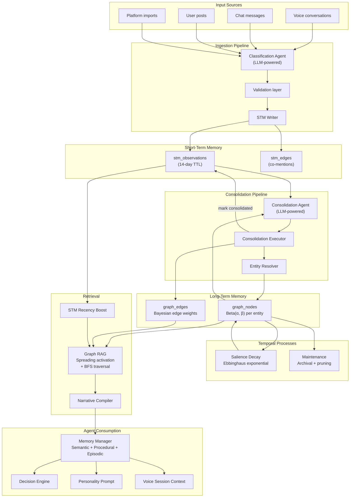

# A Dual-Memory Architecture for Bayesian Personalization in LLM Agents

**Authors:** Jaijith S

**Date:** March 2026

---

## Abstract

Large language model (LLM) agents increasingly serve as personalized companions, assistants, and autonomous actors on behalf of users. Effective personalization requires the agent to maintain an evolving, probabilistic model of the user's identity — their interests, traits, relationships, values, and preferences — that updates as new evidence accumulates across conversations, social interactions, and platform activity. We present a **Dual-Memory Architecture (DMA)** that separates raw observation capture from durable belief formation, inspired by Complementary Learning Systems theory from cognitive neuroscience. Short-Term Memory (STM) buffers classified observations in a rolling 14-day window, while Long-Term Memory (LTM) maintains a Bayesian knowledge graph where each entity carries a Beta-distributed belief, Ebbinghaus-inspired salience decay, and an append-only evidence log. An LLM-driven Consolidation Pipeline periodically transfers STM observations into LTM through five-dimensional reasoning: belief updates, salience adjustments, status transitions, frequency assessment, and conflict resolution. Retrieval combines spreading activation over Bayesian edge weights with STM recency boosting, producing structured identity narratives rather than flat label lists. We describe the full architecture as implemented in a production system, detail the mathematical formulations, and discuss the design principles that govern the separation of LLM reasoning from deterministic computation.

---

## 1. Introduction

Personalization in LLM-based agents is fundamentally a belief-tracking problem. The agent must infer who the user is — not from a static profile, but from a continuous stream of signals: what they say in voice conversations, what they post, who they mention, what topics recur, and how their preferences shift over time. These signals are noisy, partial, and sometimes contradictory. A user who mentions "trekking" once may or may not be an avid trekker; the agent needs to hold that uncertainty explicitly rather than committing prematurely.

Existing approaches to LLM personalization fall into three broad categories, each with limitations:

- **Prompt injection** appends user facts to the system prompt. This is fragile: the context window is finite, there is no principled way to prioritize which facts to include, and the model receives no uncertainty signal — a single mention is treated the same as a deeply confirmed fact.

- **Retrieval-Augmented Generation (RAG)** stores user data externally and retrieves relevant chunks at inference time. Standard RAG treats all retrieved content equally and provides no mechanism for belief evolution, evidence accumulation, or temporal decay.

- **Fine-tuning** encodes user knowledge into model weights. This is durable but static — it requires retraining to incorporate new information, and does not naturally separate uncertain from well-established beliefs.

We propose a fourth approach that combines structured external memory with Bayesian belief tracking and LLM-mediated reasoning. Our Dual-Memory Architecture draws on **Complementary Learning Systems (CLS) theory** [1], which posits that biological memory relies on two interacting systems: a fast-learning hippocampal system that rapidly encodes episodic experiences, and a slow-learning neocortical system that gradually extracts statistical regularities into durable knowledge. In our architecture:

- **Short-Term Memory (STM)** corresponds to the hippocampal system: it rapidly captures raw, classified observations from all input sources with a 14-day time-to-live.

- **Long-Term Memory (LTM)** corresponds to the neocortical system: a Bayesian knowledge graph where each entity carries a Beta distribution encoding the system's belief strength, along with temporal salience that decays according to Ebbinghaus's forgetting curve.

- **Consolidation** corresponds to the sleep-dependent memory transfer process: a scheduled LLM-driven pipeline that reasons holistically about accumulated observations and decides how they should update durable beliefs.

This paper describes the architecture as implemented in a production system serving autonomous avatar agents that act on behalf of users in a social platform. We detail the observation ontology, the STM and LTM data models, the Classification and Consolidation Agents, the salience decay mechanism, the graph-based retrieval system, and how downstream agents consume memory for decision-making.

---

## 2. Related Work

### 2.1 Complementary Learning Systems

McClelland, McNaughton, and O'Reilly [1] proposed that the mammalian brain uses two complementary learning systems: the hippocampus for rapid, one-shot encoding of episodic experiences, and the neocortex for gradual extraction of structured knowledge through repeated exposure. This theory has been influential in both cognitive science and machine learning, informing replay-based continual learning methods [2] and dual-store memory architectures. Our STM/LTM split directly instantiates this principle, with LLM-mediated consolidation serving the role of hippocampal-neocortical replay.

### 2.2 Bayesian Belief Updating

The Bayesian framework provides the normative standard for updating beliefs given new evidence [3]. In cognitive science, Bayesian models have been applied to concept learning [4], causal reasoning [5], and theory of mind [6]. Recent work by Qiu et al. [7] demonstrated that off-the-shelf LLMs struggle to perform probabilistic belief updating over multiple interactions, but can be taught to approximate Bayesian reasoning through fine-tuning on demonstrations from a normative Bayesian model ("Bayesian teaching"). Our architecture uses Beta distributions — the conjugate prior for Bernoulli-like belief — to track per-entity belief strength, and employs LLM reasoning to determine update magnitudes during consolidation.

### 2.3 Memory-Augmented Architectures

Several recent architectures integrate memory directly into the model. **MemoryLLM** [8] embeds a fixed-size memory pool in the transformer's latent space, enabling self-updating knowledge retention across nearly a million updates. **Titans** [9] introduces a neural long-term memory module with surprise-based storage and adaptive forgetting, treating attention as short-term memory and the neural module as persistent memory. **MemVerse** [10] combines short-term buffers, hierarchical knowledge graphs, and periodic parametric distillation. **Recurrent Memory Transformers (RMT)** [11] add persistent memory tokens that carry information across context segments. Our architecture operates at a higher level of abstraction: rather than modifying the transformer itself, we maintain an external structured memory that any LLM can query, with the Bayesian belief structure providing the principled uncertainty tracking that these architectures achieve through learned representations.

### 2.4 Knowledge Graphs and Graph-Based Retrieval

Graph-based approaches to LLM memory include **GraphRAG** [12], which structures retrieved content as knowledge graphs for multi-hop reasoning; **ID-RAG** [13], which uses context-aware priority-based graph querying for identity-specific retrieval; and **SYNAPSE** [14], which applies spreading activation with temporal decay across knowledge graphs. Our retrieval system synthesizes elements of all three: context-aware seed selection (ID-RAG), spreading activation with Bayesian edge weights (SYNAPSE), and BFS multi-hop traversal for evidence chains, producing structured narratives rather than flat label lists.

### 2.5 LLM Personalization

Prior work on LLM personalization includes user modeling through conversation history [15], preference elicitation through active questioning [16], and memory systems that store and retrieve user facts [17]. Our contribution differs in that we maintain *probabilistic* beliefs with explicit uncertainty, track evidence provenance, and separate the observation of raw signals from the interpretation of those signals into durable beliefs.

---

## 3. System Architecture

The Dual-Memory Architecture consists of seven interconnected components: an observation ontology, Short-Term Memory, Long-Term Memory, a Classification Agent, a Consolidation Pipeline, a salience decay service, and a maintenance system. Figure 1 illustrates the complete data flow.

*Figure 1: Complete data flow of the Dual-Memory Architecture. Solid arrows indicate data flow; the system ingests multi-source content through LLM classification into STM, consolidates into Bayesian LTM on a scheduled basis, and retrieves via graph traversal with spreading activation for downstream agent consumption.*

### 3.1 Observation Ontology

All components share a common type system that defines the vocabulary for user knowledge. This ontology ensures consistency between the Classification Agent's extraction, the Consolidation Agent's reasoning, and the retrieval system's querying.

**Entity types** define what category of knowledge an observation belongs to:

| Entity Type | Description | Example |
|---|---|---|
| `connection` | People in the user's life | "Ananya (daughter)" |
| `interest` | Activities, topics, hobbies | "cooking" |
| `fact` | Declarative knowledge about the user | "works at Amazon" |
| `trait` | Personality characteristics | "introverted" |
| `value` | Core beliefs and principles | "values family time" |
| `preference` | Stated likes/dislikes | "prefers vegetarian food" |
| `experience` | Significant life events | "traveled to Japan in 2024" |
| `demographic` | Biographical data | "born in Kerala" |

**Observation subtypes** provide fine-grained classification that the Classification Agent uses to calibrate evidence weight. For example, within the `interest` type, the subtypes `interest_explicit` ("I love cooking, it's my life"), `interest_implicit` (inferred from behavior), and `activity_mention` ("I went trekking last weekend") carry different epistemological weight — a distinction central to how the system avoids premature commitment.

**Evidence patterns** characterize the temporal distribution of evidence for a given entity:

| Pattern | Description |
|---|---|
| `single_mention` | Observed exactly once |
| `recent_burst` | Multiple mentions in a short period |
| `regular_interest` | Consistent mentions over time |
| `enduring_sporadic` | Long-term but infrequent mentions |
| `active_habit` | Frequent, sustained mentions |
| `fading` | Declining mention frequency |

**Node statuses** govern whether an entity appears in downstream identity narratives:

- `pending` — insufficient evidence; held in LTM but excluded from identity narratives
- `active` — sufficient evidence; included in personality profiles and agent decision-making
- `fading` — low salience and declining evidence; candidate for archival

### 3.2 Short-Term Memory

STM serves as a rolling buffer of raw, classified observations. Each observation is a structured record produced by the Classification Agent from an input event (voice conversation, chat message, post, or platform import).

**Schema.** An `STMObservation` record contains:

- **Entity identification:** `entity_label` (normalized lowercase), `entity_type`, `display_label`, `observation_subtype`
- **Evidence metadata:** `source` (voice, chat, post, platform\_\*), `session_id`, `raw_evidence` (quoted text), `details`
- **Agent-determined signals:** `confidence` ∈ [0, 1], `evidence_weight` ∈ [0, 3], `sentiment` ∈ [−1, 1], `reasoning` (free-text justification)
- **Correction tracking:** `observation_type` (new, correction, removal), `corrects` (label of corrected entity)
- **Temporal:** `observed_at`, `expires_at` (14 days from observation)
- **Consolidation tracking:** `consolidated` (boolean), `consolidated_at`

Co-occurring entities are also captured as `STMEdge` records linking two entity labels with a `relationship_hint`, enabling the Consolidation Agent to suggest graph edges.

**Ingestion pipeline.** All write paths converge on a single function, `classify_and_ingest`, which orchestrates three steps:

1. **Classification:** The Classification Agent (Section 3.4) extracts structured observations from raw text.
2. **Validation:** A rule-based filter rejects observations with labels shorter than 2 characters, unknown entity types, or confidence below 0.1, and clamps numeric fields to valid ranges.
3. **Writing:** The STM Writer inserts validated observations and co-mention edges into MongoDB collections with TTL indexes.

**Multi-source ingestion.** The system accepts input from voice conversation transcripts, chat messages, user-authored posts, and structured platform imports (e.g., LinkedIn profile data, YouTube watch history, Spotify listening history). Each source is tagged, enabling source-aware reasoning during consolidation.

### 3.3 Long-Term Memory

LTM is a Bayesian knowledge graph stored as two MongoDB collections: `graph_nodes` (entities) and `graph_edges` (relationships). Each node carries a rich set of Bayesian and temporal fields that distinguish this system from conventional knowledge graphs.

**Bayesian belief model.** Each entity's belief is modeled as a Beta distribution, Beta(α, β), where:

- α (alpha) accumulates positive evidence
- β (beta) accumulates negative or contradictory evidence
- **Belief strength** = α / (α + β), the mean of the distribution
- **Belief variance** = αβ / ((α + β)² (α + β + 1))
- **Belief confidence** = max(0, min(1, 1 − 4 × variance))

New entities are initialized with an **uninformative prior**, Beta(1, 1), corresponding to maximum uncertainty. Verified data (user profile edits) starts with Beta(3, 1), and human-curated data with Beta(5, 1).

**Evidence tracking.** Each node maintains an append-only `evidence_log` — a chronological list of evidence entries, each recording the timestamp, source, weight, subtype, and session ID. This log is never modified or deleted; it provides a complete audit trail of how a belief was formed. Additionally, `evidence_count`, `first_evidence_at`, `last_evidence_at`, and `evidence_span_days` summarize the evidence history.

**Temporal salience.** Each node carries a `salience` score ∈ [0, 1] representing how "top of mind" the entity currently is, along with a `salience_stability` parameter (in days) governing decay rate. Salience is distinct from belief strength: an entity can have high belief strength (well-established fact) but low salience (not recently relevant), or vice versa.

**Narrative descriptors.** Each node may carry a `narrative_descriptor` — a short natural-language phrase (e.g., "passionate trekker," "born in Kerala") that the Consolidation Agent generates. These descriptors are used by the retrieval system to compile identity narratives without requiring additional LLM calls at retrieval time.

**Edges.** Relationships between entities are stored with Bayesian edge parameters: `belief_alpha`, `belief_beta`, and `edge_strength`. Edge types include `co_interest`, `part_of`, and `related_to`. Edges carry temporal validity (`valid_from`, `valid_until`) and evidence counts.

### 3.4 Classification Agent

The Classification Agent is an LLM-powered component that runs in real time on each input event. Its role is to extract structured observations from unstructured text, calibrating the epistemological weight of each observation.

**Epistemological calibration.** The agent's system prompt establishes a framework for distinguishing different levels of evidential strength:

- A biographical fact stated definitively ("I was born in India") warrants high confidence from a single utterance.
- An activity mentioned once ("I went trekking") is a behavioral data point, not a confirmed interest.
- An explicit passion ("I love cooking, it's my life") carries strong interest evidence in a single statement.
- A hedged statement ("I think maybe I like hiking") is low-confidence.
- A hypothetical ("I should try yoga someday") is not an observation at all.

The agent is instructed to reason about each extraction individually and to produce calibrated `confidence` and `evidence_weight` scores with explicit reasoning. The prompt includes a betting metaphor: "if you had to bet money on whether this person genuinely has this attribute, how much would you bet based on this utterance alone?"

**Existing-data awareness.** Before classification, the system loads the user's current LTM state (top nodes by salience) and provides it to the agent. This enables detection of corrections ("not X, it's Y") and updates to existing entities, which are tagged with `observation_type: correction` and `corrects: <label>`.

**Output structure.** The agent returns a JSON object containing:
- A list of `ClassifiedObservation` records, each with entity type, subtype, label, quoted evidence, confidence, evidence weight, sentiment, and reasoning.
- A list of `CoMention` records identifying entities that appeared together in the content.
- Free-text `classification_notes` summarizing the agent's assessment of the content's overall informativeness.

### 3.5 Consolidation Pipeline

The Consolidation Pipeline transfers accumulated STM observations into durable LTM beliefs. It runs as a scheduled batch process (daily or threshold-triggered) and consists of four stages.

**Stage 1: Loading.** The pipeline loads all unconsolidated `stm_observations` (up to 500) and current `graph_nodes` (with Bayesian fields) for the target user.

**Stage 2: Consolidation Agent.** An LLM-powered Consolidation Agent receives the STM observations and current LTM state and produces a `ConsolidationResult` containing a decision for each mentioned entity. Each decision is five-dimensional:

1. **Belief update:** `delta_alpha` ∈ [0, 3] and `delta_beta` ∈ [0, 1], determining how much positive and negative evidence to add to the Beta distribution. The agent is instructed that a definitive fact deserves δα ≈ 2.5+, a single activity mention deserves δα ≈ 0.2–0.5, and repeated enthusiastic mentions deserve cumulative weight.

2. **Salience update:** `new_salience` ∈ [0, 1] and `new_stability_days` ∈ [7, 365]. Enduring interests receive stability of 180–365 days; fleeting mentions receive 7–30 days. The agent applies a spaced repetition heuristic: if evidence arrives after a long gap, stability increases significantly.

3. **Status decision:** Whether the entity should be `active`, `pending`, or `fading`, with entity-type-specific rules of thumb (facts become active after 1 confident mention; interests after 2+ mentions or 1 strong explicit mention; traits after 2+ behavioral signals).

4. **Frequency assessment:** An `evidence_pattern` classification (single mention through active habit), a `narrative_descriptor` for identity compilation, and an estimated `mention_frequency_per_month`.

5. **Conflict resolution:** Whether the observations contradict existing LTM data, and if so, a resolution strategy (keep newer, keep both, merge with qualification).

The Consolidation Agent also suggests new edges where entities are frequently co-mentioned, and provides knowledge-gap coverage updates across eight identity dimensions (life narrative, values/beliefs, communication style, social patterns, interests/passions, emotional patterns, daily life, humor/personality).

**Stage 3: Execution.** The `ConsolidationExecutor` applies each decision:

- For existing nodes: increments α and β, recomputes belief strength/variance/confidence, updates salience and stability, appends to the evidence log, updates status and frequency metrics.
- For new nodes: creates a graph node with Beta(1 + δα, 1 + δβ) prior, initializes all Bayesian and temporal fields.
- For suggested edges: resolves endpoint nodes by label, creates edges with Bayesian defaults, avoids duplicates.
- Marks all processed STM observations as `consolidated: true`.

**Stage 4: Post-processing.** After execution, the salience decay service runs (Section 3.6), and a cache-invalidation signal is written to `graph_cache_bust` so that retrieval caches are refreshed.

**Entity resolution.** The `EntityResolver` maps STM entity labels to existing LTM nodes, handling type-level mappings (e.g., an STM "preference" may match an LTM node of type "interest" or "fact") and canonical ID formats.

**Scheduling.** The `ConsolidationScheduler` supports two trigger modes:

1. **Daily batch:** Runs at a scheduled time for all users with unconsolidated observations.
2. **High-activity threshold:** If a user accumulates more than 50 unconsolidated observations, early consolidation is triggered (with a 4-hour cooldown to prevent rapid re-consolidation).

Run metadata is recorded in a `consolidation_runs` collection for auditing and cooldown checks.

### 3.6 Salience Decay

Temporal salience decays according to Ebbinghaus's forgetting curve [18], implemented as a pure-math service with no LLM involvement.

**Decay function.** For each LTM node, the new salience after elapsed time Δt (in days) is:

$$R = S \cdot \exp\left(-\frac{\Delta t}{\tau}\right)$$

where S is the previous salience and τ is the `salience_stability` parameter (in days). This produces exponential decay where higher-stability entities (facts, enduring interests) retain salience much longer than low-stability entities (fleeting mentions).

**Fading transition.** When salience drops below a threshold of 0.05, the node's status transitions from `active` to `fading`. A floor salience of 0.01 prevents nodes from reaching zero (allowing recovery if new evidence arrives).

**Stability differentiation.** The Consolidation Agent sets stability based on entity type and evidence pattern:

| Context | Typical stability (days) |
|---|---|
| Definitive facts | 365+ |
| Enduring interests | 180–365 |
| Active habits | 90–180 |
| Regular interests | 30–90 |
| Fleeting mentions | 7–30 |

This creates a natural hierarchy where biographical facts are nearly permanent, while casual mentions fade within weeks unless reinforced.

### 3.7 Memory Maintenance

A weekly maintenance process performs four housekeeping tasks:

1. **Archive fading nodes.** Nodes with status `fading` and salience below 0.02 for more than 30 days are moved to a `graph_nodes_archive` collection. They can be restored if new evidence arrives.

2. **Prune orphan edges.** Edges where one or both endpoint nodes no longer exist in `graph_nodes` are deleted.

3. **Clean expired STM.** Consolidated STM observations older than 30 days are deleted. (MongoDB TTL indexes handle most expiry, but consolidated observations with extended `expires_at` can linger.)

4. **Compact evidence logs.** Nodes with more than 50 entries in their `evidence_log` are compacted: the oldest entries are summarized and the array is trimmed to the most recent 50, preventing unbounded document growth.

---

## 4. Retrieval: Graph RAG

The retrieval layer transforms the LTM knowledge graph into LLM-ready identity narratives. Rather than dumping raw node labels into the prompt, the system performs structured graph traversal to produce connected narratives that convey how different aspects of identity relate to each other.

### 4.1 In-Memory Graph Representation

For each user, the full graph (nodes + edges) is loaded into an `InMemoryGraph` data structure with adjacency lists (outgoing and incoming), type-based indexes (`by_type`), and label-based lookups (`by_label`). The graph is cached with a 5-minute TTL and invalidated when the consolidation pipeline signals a cache bust.

### 4.2 Bayesian-Aware Node Strength

Node retrieval priority follows a fallback chain that prefers the most informative signal available:

1. **Salience** — temporal relevance (best for "what's active now")
2. **Belief strength** — Bayesian conviction (best for "what do we know")
3. **Legacy strength** — top-level `strength` field (backwards compatibility)
4. **Property strength** — nested `properties.strength` (default 0.5)

This ensures that recently salient entities are prioritized for current context, while well-established entities are not lost even if salience has decayed.

### 4.3 STM Recency Boosting

To ensure that very recent observations influence retrieval even before consolidation runs, the system loads STM observations from the last 3 days and computes a per-label recency boost (capped at 0.3). This boost is added to the activation of matching LTM nodes during retrieval, creating a smooth transition between STM immediacy and LTM durability.

### 4.4 Context-Aware Seed Selection

Inspired by ID-RAG [13], the retrieval system selects seed nodes based on the action context rather than using a fixed top-N strategy. Seed selection strategies include:

- **Post generation:** Seed from topic-matching interests, weighted sample of strong interests, and high-strength traits/values.
- **Chat response:** Seed from shared interests with the conversation partner, connections, and traits.
- **Personality profile:** Seed from all nodes above a strength threshold for comprehensive coverage.
- **Decision making:** Seed from interests (which inform preference-based action selection).
- **General:** Top 20 nodes by strength.

### 4.5 Spreading Activation

From the seed nodes, activation energy propagates through edges using a spreading activation algorithm inspired by SYNAPSE [14]:

$$a_j^{(t+1)} = \max\left(a_j^{(t)},\; \max_{i \in \mathcal{N}(j)} \; a_i^{(t)} \cdot w_{ij} \cdot \gamma\right)$$

where \(a_i^{(t)}\) is the activation of node i at step t, \(w_{ij}\) is the Bayesian edge weight (preferring `edge_strength` from the Beta distribution, falling back to legacy `weight`), and γ is a decay factor (0.5 for most contexts, 0.6 for personality profiles). Propagation halts when activation falls below a threshold (0.05 standard, 0.03 for profiles) or after 3 steps.

Lateral inhibition is implicit: only the maximum incoming activation is kept for each node, preventing runaway accumulation from multiple paths.

### 4.6 BFS Multi-Hop Traversal

Complementing spreading activation, a BFS traversal from seed nodes collects evidence chains up to 2–3 hops (depending on context), using a minimum edge weight of 0.2. Nodes discovered by BFS but not reached by spreading activation receive a distance-based activation of \(0.5^d\) where d is the hop distance.

### 4.7 Narrative Compilation

The activated subgraph is compiled into a structured identity narrative organized by entity type:

1. **Identity** (demographics): Biographical facts as a concise sentence.
2. **Important people** (connections): Names with relationships and edge context.
3. **Life experiences**: Significant events with connected context.
4. **Interests and passions**: Clustered by graph connectivity (using union-find), with cross-type connections shown (e.g., "cooking, Italian cuisine → related_to food culture").
5. **Character traits**: With supporting details.
6. **Core values**: With supporting details.
7. **Preferences**: Stated likes and dislikes.

Interest clustering groups graph-connected interests together, revealing thematic structures (e.g., "cooking" and "Italian cuisine" appear together rather than as unrelated items). Cross-type connections are surfaced to show how interests relate to values, experiences, or people.

The narrative is constrained to a character budget (default 6000 characters, approximately 1500 tokens), with sections added greedily by priority. Narrative descriptors from consolidation (e.g., "passionate trekker") are preferred over raw labels, producing more natural text.

---

## 5. Agent Memory Consumption

The memory system serves multiple downstream consumers, each requiring different views of the user's identity.

### 5.1 Memory Manager

The `MemoryManager` provides a unified interface combining three memory subsystems:

- **Semantic memory** (via GraphRAG): Interests, traits, values, preferences, and a compiled identity narrative from the knowledge graph. Retrieved using the context-aware spreading activation described in Section 4.
- **Procedural memory** (via ActionMemory): Action success rates, best-performing action types, recent action history, and a list of consistently failing actions to avoid. Stored in `avatar_action_memory` as outcome-annotated action records.
- **Episodic memory** (via EpisodicMemory): Significant experiences with emotional valence (−1 to 1) and significance scores (0 to 1), emotional summaries over configurable time windows, and relationship-specific memories.

The full memory context is assembled with a 5-minute cache TTL and returned as a structured dictionary that downstream components consume.

### 5.2 Decision Engine Integration

The `DecisionEngine` orchestrates action selection for autonomous avatar agents, integrating memory through a `memory_context` parameter. Memory informs decisions through three channels:

1. **Interest alignment** (semantic memory): Actions are scored higher when they align with the user's known interests. Posts about topics matching graph interests receive a +0.3 utility bonus; actions pre-marked as interest-aligned receive +0.2.

2. **Past success alignment** (procedural memory): Action types with high historical success rates (>0.7) receive a +0.2 bonus; consistently failing types (<0.3) receive a −0.2 penalty. The user's best-performing action type receives an additional +0.15.

3. **Emotional alignment** (episodic memory): If the user's emotional trend is declining, social actions (messaging, liking, commenting) receive a bonus to improve mood. If the trend is improving, current behavioral patterns are reinforced.

### 5.3 Action-Outcome Feedback Loop

When an action completes, the `MemoryManager` records the outcome across multiple memory systems:

- **Procedural memory** always receives the outcome for success-rate tracking.
- **Episodic memory** receives outcomes that exceed a significance threshold (≥ 0.4), computed from action type base significance plus engagement bonuses (likes > 3: +0.2, reply received: +0.2, friend request accepted: +0.3). Emotional valence is computed from outcome signals: success (+0.3), likes (+0.1 per like, capped), replies (+0.3), accepted requests (+0.4), rejected requests (−0.4).

This feedback loop allows the agent to learn from its actions: successful social strategies are reinforced, while unsuccessful patterns are gradually avoided.

### 5.4 Voice Session Memory

Voice conversations require a distinct memory retrieval path optimized for real-time response (target: <3 seconds). The `VoiceMemoryService` retrieves:

- All user connections (people)
- All interests from the knowledge graph with strength scores
- Identity facts and preferences
- Recent conversation summaries (up to 10) from the `episodic_memory` collection
- Recent user posts (up to 10) for conversational context

These are fetched in parallel with timeouts and formatted into a concise memory prompt for the voice model.

**Conversation recall** is handled by a multi-layer search service that queries, in order: (1) `conversation_index` for lightweight summaries, (2) `episodic_memory` for deeper context, (3) S3-stored full transcripts when detailed recall is needed. Results are deduplicated by session ID.

---

## 6. Design Principles

Six principles govern the architecture's design:

### 6.1 Separation of Observation from Belief

STM records raw observations; LTM holds interpreted beliefs. A single mention of "trekking" creates an STM observation with moderate evidence weight, but does not immediately create a strong LTM belief. Only after consolidation — where the observation is considered alongside all other evidence — does it update the belief. This prevents premature commitment and allows the system to reason holistically about evidence patterns.

### 6.2 Bayesian Uncertainty over Point Estimates

Rather than storing binary "user likes X" flags, the system maintains Beta distributions that encode both the direction and certainty of a belief. A Beta(5, 1) encodes a strong, well-supported interest; a Beta(1.5, 1) encodes a tentative signal. Downstream consumers can access belief strength, variance, and confidence, enabling appropriately uncertain reasoning.

### 6.3 LLM Reasoning at Decision Boundaries

LLMs are used where judgment is required: extracting observations from natural language (Classification Agent) and reasoning about how observations should update beliefs (Consolidation Agent). Deterministic computation is used everywhere else: salience decay (exponential math), retrieval priority (sorting and graph traversal), validation (rule-based filtering), and maintenance (threshold-based archival). This minimizes cost and latency while reserving LLM capability for the tasks that genuinely require it.

### 6.4 Append-Only Evidence

The evidence log on each LTM node is never modified or deleted (except for compaction of very long logs during maintenance, which preserves a summary). This provides a complete audit trail of how every belief was formed, enabling debugging, conflict resolution, and potential re-evaluation of beliefs if consolidation logic is updated.

### 6.5 Graceful Degradation

All memory-consuming components provide meaningful fallback values when memory is unavailable. The `MemoryManager` returns empty interest/trait/value lists with neutral procedural and episodic defaults. The `DecisionEngine` uses a 0.5 (neutral) memory alignment score. Voice sessions function with empty memory contexts. No downstream component crashes or produces degenerate behavior due to missing memory.

### 6.6 Temporal Stratification

The architecture operates across multiple timescales:

- **Milliseconds:** In-memory graph cache serves retrieval without database queries.
- **Seconds:** STM recency boost injects very recent observations into retrieval.
- **Hours:** High-activity threshold triggers early consolidation.
- **Days:** Scheduled consolidation transfers observations to LTM; salience decays.
- **Weeks:** Maintenance archives fading nodes and prunes orphan edges.
- **Months–years:** Well-established beliefs (high α, high stability) persist indefinitely.

---

## 7. Discussion

### 7.1 Limitations

**Heuristic Bayesian updates.** The Consolidation Agent determines δα and δβ through prompted reasoning, not normative Bayesian inference. As Qiu et al. [7] demonstrated, off-the-shelf LLMs struggle with probabilistic belief updating. The agent's calibration depends on prompt engineering quality rather than mathematical guarantees. Future work could apply Bayesian teaching — fine-tuning the consolidation model on demonstrations from a normative Bayesian model — to improve calibration.

**Independent entity beliefs.** The system maintains independent Beta distributions per entity, with no joint posterior across the full belief space. Learning that a user loves "cooking" does not formally update beliefs about "Italian cuisine" or "food culture," even though these are likely correlated. Edge co-mentions and spreading activation provide informal correlation, but lack the mathematical guarantees of a joint distribution. Implementing correlated belief updates along high-weight edges during consolidation could partially address this.

**Classification confidence calibration.** The Classification Agent's confidence and evidence-weight scores are self-reported by the LLM, which is not known to be well-calibrated for probability estimation [19]. Systematic calibration evaluation against ground-truth annotations would quantify and potentially improve this.

**Batch consolidation latency.** The default consolidation cycle is daily, meaning new observations may take up to 24 hours to update LTM beliefs. The STM recency boost partially mitigates this for retrieval, but downstream consumers that depend on LTM belief strength (e.g., status transitions) are affected. The threshold-based trigger reduces this for high-activity users.

### 7.2 Relationship to Normative Bayesian Framework

The Bayesian teaching paper [7] establishes that LLMs can learn to approximate normative Bayesian inference through supervised fine-tuning on demonstrations from a Bayesian model, and that this skill generalizes to new domains. Our architecture is structurally compatible with this finding: the Classification and Consolidation Agents could be fine-tuned on normative demonstrations (observation sequences paired with the mathematically correct belief updates) to replace prompted heuristics with learned Bayesian reasoning. The Bayesian fields already present in LTM (α, β, variance, confidence) would provide the ground-truth targets for such training.

### 7.3 Relationship to Memory-Augmented Architectures

Our system operates at a higher abstraction level than architectures that modify the transformer itself (MemoryLLM [8], Titans [9], RMT [11]). This has trade-offs: we gain interpretability (every belief has an auditable evidence trail), model-agnosticism (any LLM can query the memory), and structured uncertainty (explicit Beta distributions). We sacrifice the potential for tighter integration where the model's internal representations directly encode user knowledge. A hybrid approach — using our Bayesian knowledge graph as a structured source-of-truth while distilling it periodically into model weights via parametric memory (as in MemVerse [10]) — could combine the strengths of both paradigms.

---

## 8. Conclusion

We have presented the Dual-Memory Architecture, a production system for Bayesian personalization in LLM agents. The architecture separates fast observation capture (STM) from durable belief formation (LTM), uses Beta distributions to track belief strength with explicit uncertainty, employs LLM-mediated consolidation for holistic evidence reasoning, and applies Ebbinghaus-inspired salience decay for temporal relevance. The retrieval layer combines spreading activation over Bayesian edge weights with context-aware seed selection and narrative compilation, producing connected identity narratives rather than flat lists. Downstream agents consume memory through a unified interface that combines semantic, procedural, and episodic memory, with action-outcome feedback loops enabling continuous learning.

The key insight underlying this architecture is that personalization is not a retrieval problem but a belief-tracking problem. Users do not present their identities as structured databases; they reveal fragments gradually, sometimes hedging, sometimes contradicting prior statements, sometimes repeating themes that grow clearer over time. A memory system for personalization must be comfortable with uncertainty, accumulate evidence across timescales, and separate what was observed from what is believed. The Dual-Memory Architecture implements these principles in a production system that serves autonomous agents acting on behalf of real users.

---

## Appendix A: Mathematical Formulations

### A.1 Beta Distribution Belief Model

Each entity's belief is modeled as a Beta distribution with parameters α (positive evidence) and β (negative/contradictory evidence):

$$p(\theta \mid \alpha, \beta) = \frac{\theta^{\alpha-1}(1-\theta)^{\beta-1}}{B(\alpha, \beta)}$$

**Belief strength** (mean):

$$\mu = \frac{\alpha}{\alpha + \beta}$$

**Belief variance:**

$$\sigma^2 = \frac{\alpha \beta}{(\alpha + \beta)^2 (\alpha + \beta + 1)}$$

**Belief confidence** (derived from variance):

$$c = \max\left(0,\; \min\left(1,\; 1 - 4\sigma^2\right)\right)$$

The factor of 4 normalizes against the maximum variance of 0.25 (which occurs at α = β = 1, the uninformative prior).

**Consolidation update.** Given a consolidation decision with increments δα and δβ:

$$\alpha' = \alpha + \delta\alpha, \quad \beta' = \beta + \delta\beta$$

New belief strength, variance, and confidence are recomputed from the updated parameters.

### A.2 Salience Decay

Salience decays exponentially according to the Ebbinghaus forgetting curve:

$$R(t) = S_0 \cdot \exp\left(-\frac{\Delta t}{\tau}\right)$$

where \(S_0\) is the salience at last computation, Δt is elapsed days, and τ is the stability parameter. A floor of 0.01 prevents complete decay:

$$S' = \max(0.01, \; R(t))$$

Status transitions are triggered when salience crosses the fading threshold:

$$\text{status} \leftarrow \text{fading} \quad \text{if } S' < 0.05 \text{ and status} = \text{active}$$

### A.3 Spreading Activation

Given seed activations \(\{a_i^{(0)}\}\) and adjacency structure:

$$a_j^{(t+1)} = \max\left(a_j^{(t)},\; \max_{i \in \mathcal{N}(j)} \; a_i^{(t)} \cdot w_{ij} \cdot \gamma\right)$$

where \(w_{ij}\) is the Bayesian edge weight:

$$w_{ij} = \begin{cases} \text{edge\_strength}_{ij} & \text{if Bayesian fields exist} \\ \text{weight}_{ij} & \text{otherwise} \end{cases}$$

and γ is the decay factor (0.5 standard, 0.6 for personality profiles). Propagation terminates when no activation exceeds the threshold (0.05 standard, 0.03 for profiles) or after 3 steps.

### A.4 Bayesian Edge Weight

Edge strength follows the same Beta model as node belief:

$$w_{ij} = \frac{\alpha_{ij}}{\alpha_{ij} + \beta_{ij}}$$

New edges are initialized with α = 1 + 2w (where w is the legacy weight) and β = 1, biasing toward the legacy weight while allowing Bayesian updating.

---

## Appendix B: Observation Ontology Reference

### B.1 Entity Types

| Type | Description |
|---|---|
| `connection` | People in the user's life |
| `interest` | Activities, topics, hobbies |
| `fact` | Declarative knowledge |
| `trait` | Personality characteristics |
| `value` | Core beliefs and principles |
| `preference` | Stated likes/dislikes |
| `experience` | Significant life events |
| `demographic` | Biographical data |

### B.2 Observation Subtypes

| Subtype | Category | Description |
|---|---|---|
| `fact_declarative` | Facts | Stated fact ("I work at Amazon") |
| `fact_biographical` | Facts | Life history ("born in Kerala") |
| `fact_temporal` | Facts | Time-bound fact ("moved to Bangalore in 2020") |
| `connection_definitive` | Connections | Clear relationship ("my daughter Ananya") |
| `connection_mentioned` | Connections | Casual mention of a person |
| `interest_explicit` | Interests | Declared interest ("I love cooking") |
| `interest_implicit` | Interests | Inferred from behavior |
| `activity_mention` | Interests | Single activity mention ("went trekking") |
| `trait_self_declared` | Traits | User states trait ("I'm introverted") |
| `trait_behavioral` | Traits | Inferred from behavior patterns |
| `value_explicit` | Values | Stated value ("family is most important") |
| `value_implicit` | Values | Inferred from decisions |
| `preference_stated` | Preferences | Explicit preference ("I prefer vegetarian") |
| `sentiment_expression` | Preferences | Emotional reaction to topic |
| `experience_significant` | Experiences | Major life event |
| `experience_episodic` | Experiences | Conversational episode |
| `correction` | Meta | Corrects prior observation |
| `removal` | Meta | Negates prior observation |

### B.3 Evidence Patterns

| Pattern | Description | Typical stability (days) |
|---|---|---|
| `single_mention` | One observation | 7–14 |
| `recent_burst` | Multiple mentions, short period | 14–30 |
| `regular_interest` | Consistent over time | 30–90 |
| `enduring_sporadic` | Long-term but infrequent | 90–180 |
| `active_habit` | Frequent and sustained | 180–365 |
| `fading` | Declining frequency | 7–14 |
| `migration` | Pre-existing node migrated to Bayesian schema | Inherited |

### B.4 Node Statuses

| Status | Description | Appears in narratives? |
|---|---|---|
| `pending` | Insufficient evidence | No |
| `active` | Confirmed belief | Yes |
| `fading` | Low salience, declining evidence | No (candidate for archival) |

---

## References

[1] McClelland, J. L., McNaughton, B. L., & O'Reilly, R. C. (1995). Why there are complementary learning systems in the hippocampus and neocortex: Insights from the successes and failures of connectionist models of learning and memory. *Psychological Review*, 102(3), 419–457.

[2] Shin, H., Lee, J. K., Kim, J., & Kim, J. (2017). Continual learning with deep generative replay. *Advances in Neural Information Processing Systems*, 30.

[3] Chater, N., Tenenbaum, J. B., & Yuille, A. (2006). Probabilistic models of cognition: Conceptual foundations. *Trends in Cognitive Sciences*, 10(7), 287–291.

[4] Tenenbaum, J. B., Kemp, C., Griffiths, T. L., & Goodman, N. D. (2011). How to grow a mind: Statistics, structure, and abstraction. *Science*, 331(6022), 1279–1285.

[5] Griffiths, T. L., Steyvers, M., & Tenenbaum, J. B. (2007). Topics in semantic association. *Psychological Review*, 114(2), 211–244.

[6] Baker, C., Saxe, R., & Tenenbaum, J. (2011). Bayesian theory of mind: Modeling joint belief-desire attribution. *Proceedings of the Annual Meeting of the Cognitive Science Society*, 33.

[7] Qiu, L., Sha, F., Allen, K., Kim, Y., Linzen, T., & van Steenkiste, S. (2026). Bayesian teaching enables probabilistic reasoning in large language models. *Nature Communications*, 17, 1238.

[8] Wang, Y., Gao, Y., Chen, X., et al. (2024). MEMORYLLM: Towards self-updatable large language models. *Proceedings of the 41st International Conference on Machine Learning (ICML)*.

[9] Behrouz, A., Zhong, P., & Mirrokni, V. (2025). Titans: Learning to memorize at test time. *Advances in Neural Information Processing Systems (NeurIPS)*.

[10] MemVerse: Multimodal memory for lifelong learning agents. (2025). *arXiv preprint arXiv:2512.03627*.

[11] Bulatov, A., Kuratov, Y., & Burtsev, M. (2022). Recurrent memory transformer. *Advances in Neural Information Processing Systems*, 35.

[12] Edge, D., et al. (2024). From local to global: A graph RAG approach to query-focused summarization. *arXiv preprint arXiv:2404.16130*.

[13] MIT Media Lab. ID-RAG: Context-aware priority-based graph querying for identity-specific retrieval.

[14] SYNAPSE: Spreading activation with temporal decay for knowledge graphs.

[15] Li, B. Z., Tamkin, A., Goodman, N. D., & Andreas, J. (2025). Eliciting human preferences with language models. *International Conference on Learning Representations*.

[16] Handa, K., et al. (2024). Bayesian preference elicitation with language models. *arXiv preprint arXiv:2403.05534*.

[17] Modular Memory is the Key to Continual Learning Agents. (2026). *arXiv preprint arXiv:2603.01761*.

[18] Ebbinghaus, H. (1885). *Über das Gedächtnis: Untersuchungen zur experimentellen Psychologie*. Leipzig: Duncker & Humblot.

[19] Zhu, J.-Q., & Griffiths, T. L. (2024). Incoherent probability judgments in large language models. *Proceedings of the 46th Annual Conference of the Cognitive Science Society*.
